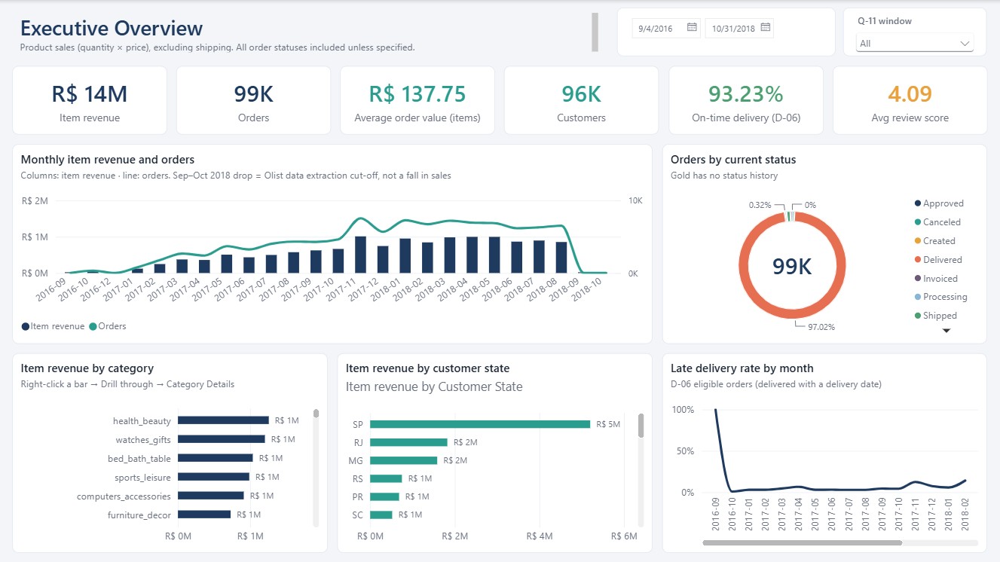
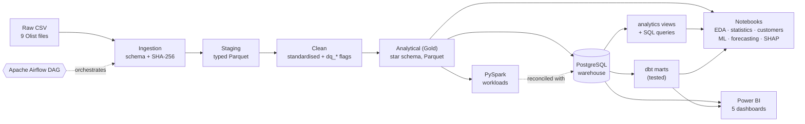
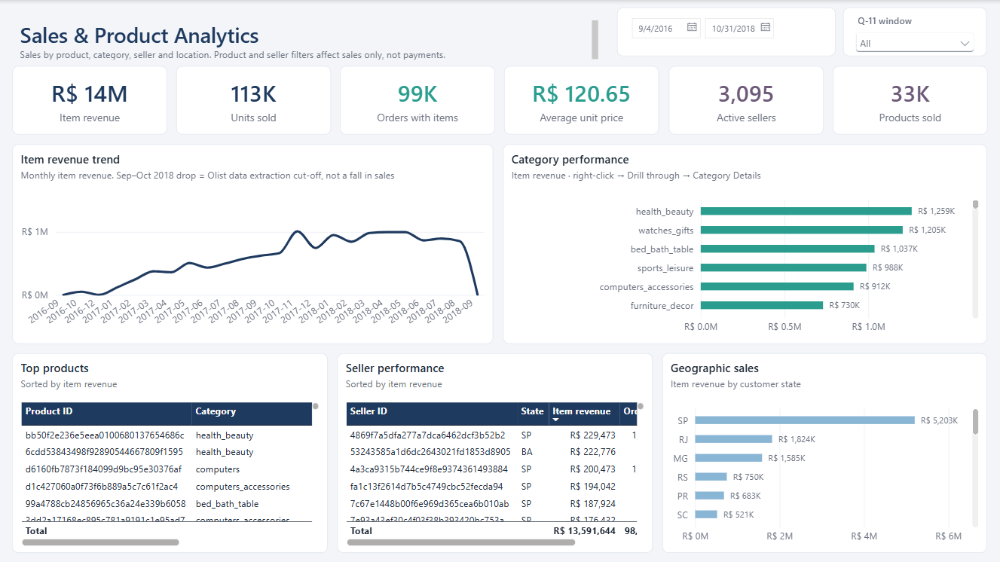
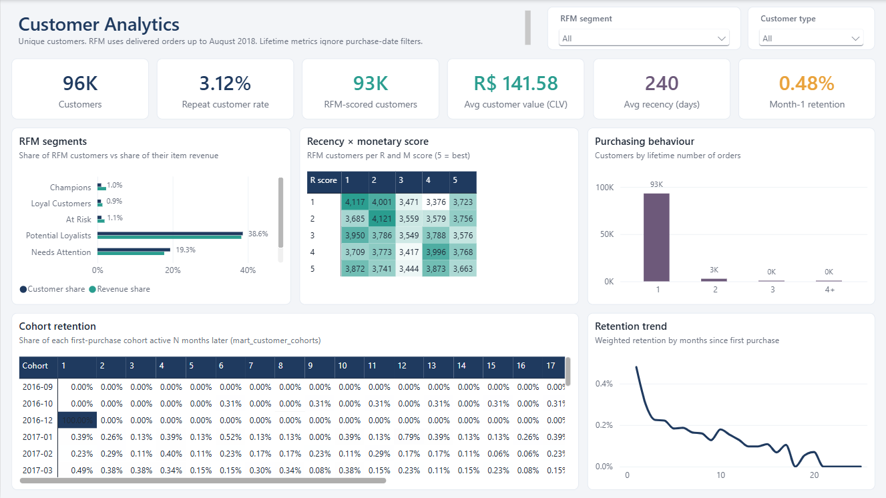

# Retail Intelligence — End-to-End E-Commerce Analytics Platform

**From raw marketplace data to a validated warehouse, machine-learning models and executive dashboards.**


Retail Intelligence is an end-to-end analytics project built on the public **Olist Brazilian E-Commerce dataset**: about 100,000 orders placed between 2016 and 2018 across the 9 related tables of a real marketplace. It covers the whole lifecycle:
- a layered, checksummed and fully traced **data pipeline** (raw → staging → clean → star schema);
- a **PostgreSQL warehouse** with SQL views and tested **dbt** marts;
- **PySpark** workloads and **Airflow** orchestration;
- statistical analysis, **customer analytics**, **machine learning**, **forecasting** and **explainable AI**;
- five **Power BI** dashboards whose KPIs were validated against the warehouse.

Results are reproduced from code, with fixed seeds, run manifests and idempotent commands. The data-preparation decisions and business rules are documented in [`reports/data_preparation_strategy.md`](reports/data_preparation_strategy.md).

<p align="center">
  <a href="dashboards/README.md"></a>
  <br><sub>Executive Overview: one of five Power BI dashboards (<a href="dashboards/README.md">all dashboards</a>)</sub>
</p>

## Contents

[Key features](#key-features) · [Architecture](#architecture) · [Dataset](#dataset) · [Technology stack](#technology-stack) · [Project phases](#project-phases) · [Results](#results) · [Dashboards](#dashboards) · [Getting started](#getting-started) · [Repository structure](#repository-structure) · [Testing](#testing) · [Limitations](#limitations) · [Future improvements](#future-improvements) · [Acknowledgements and licensing](#acknowledgements-and-licensing) · [Technical reference](#technical-reference)

## Key features

- **Data you can trust:**
  - SHA-256 checksums on every raw file;
  - explicit schemas;
  - a JSON lineage manifest for every run;
  - blocking validation checks;
  - row counts and money totals reconciled at each layer.
- **Fan-out-safe star schema:** every one-to-many table is aggregated before it is joined, and every join is validated. Item revenue and payment value are kept separate by design.
- **Documented decisions, not silent cleaning:** data-quality issues are flagged (`dq_*` columns), never deleted or imputed. Open business questions (Q-xx) and decisions (D-xx) are recorded and referenced in the code.
- **Warehouse and analytics engineering:** PostgreSQL star schema, 7 analytics views, 20 parameterised SQL queries and 5 tested dbt marts. The schemas are owned by a least-privilege application role.
- **Scale-out and orchestration:** PySpark workloads with plan-level optimisation and a pandas-vs-Spark benchmark, plus an idempotent Airflow DAG with retries.
- **Data science with leakage control:** temporal validation, pipelines fitted on training folds only, honest baselines, and SHAP explanations checked for additivity.
- **Validated BI:** a Power BI Project (`.pbip`, text-based and version-controlled), with every page KPI, slicer and drill-through cross-checked against PostgreSQL.

## Architecture



- **Python layers:** ingestion, staging, clean and analytical are Python packages under `src/`. Each layer reads only the previous layer's output, refuses to run on stale or changed inputs, and writes Parquet with lineage metadata plus a JSON or Markdown report.
- **Warehouse:** the Gold star schema is loaded into PostgreSQL as a faithful relational copy. SQL views, approved analytical queries and dbt marts build on it. The customer and forecasting notebooks reuse the queries and marts, and Power BI imports the star schema and the cohort mart. The views also serve as the reference for validating dashboard KPIs.
- **PySpark:** reruns three workloads on the Gold Parquet files and is reconciled against PostgreSQL.
- **Airflow:** orchestrates the whole chain: `ingest → staging → clean → analytical → load_warehouse → verify_views → dbt_build → spark_reconcile`, with `spark_jobs` in parallel.

## Dataset

[Brazilian E-Commerce Public Dataset by Olist](https://www.kaggle.com/datasets/olistbr/brazilian-ecommerce), published on Kaggle by Olist: orders placed on Brazilian marketplaces, with customers, items, payments, reviews, products, sellers and geolocation.

| File | Rows | Content |
|---|---:|---|
| `olist_orders_dataset.csv` | 99,441 | Order status and purchase, approval, carrier, delivery and estimated dates |
| `olist_order_items_dataset.csv` | 112,650 | Items per order: product, seller, price, freight |
| `olist_order_payments_dataset.csv` | 103,886 | Payment method, instalments, value |
| `olist_order_reviews_dataset.csv` | 99,224 | Review score, comments, dates |
| `olist_customers_dataset.csv` | 99,441 | Customer per order, unique person id, location |
| `olist_products_dataset.csv` | 32,951 | Category and physical attributes |
| `olist_sellers_dataset.csv` | 3,095 | Seller location |
| `olist_geolocation_dataset.csv` | 1,000,163 | Zip-code prefix coordinates |
| `product_category_name_translation.csv` | 71 | Portuguese → English category names |

- **Period:** purchases from 2016-09-04 to 2018-10-17. The extract becomes incomplete after 2018-08-21, so analyses use the candidate window 2017-01 to 2018-08 as a documented flag, never as a silent filter.
- **Entities:** 96,096 unique customers (`customer_unique_id`), 32,951 products and 3,095 sellers.
- **Not in the repository:** the raw data (licence terms and size). Download it from Kaggle into `data/raw/` (see [Getting started](#getting-started)).

## Technology stack

| Area | Tools |
|---|---|
| Language and environments | Python 3.12, separate virtual environments per tool (`.venv`, `.venv-dbt`, WSL2 venvs for Spark and Airflow) |
| Data processing | pandas 3.1, NumPy, PyArrow / Parquet |
| Database and SQL | PostgreSQL 18, SQLAlchemy 2.1, psycopg 3 |
| Analytics engineering | dbt-core 1.12 with dbt-postgres |
| Distributed processing | PySpark 4.2 (Java 17, WSL2) |
| Orchestration | Apache Airflow 3.3.2 (WSL2) |
| Statistics and machine learning | SciPy, statsmodels, scikit-learn 1.9, SHAP 0.54 |
| Visualisation and BI | Matplotlib, seaborn, Plotly, Jupyter; Power BI Desktop (Power BI Project: TMDL model, PBIR report, DAX) |
| Quality | `unittest` suite, dbt tests, schema and reconciliation checks, run manifests |

Pinned versions: [`requirements-lock.txt`](requirements-lock.txt), [`requirements-dbt-lock.txt`](requirements-dbt-lock.txt), [`requirements-spark.txt`](requirements-spark.txt), [`requirements-airflow.txt`](requirements-airflow.txt).

## Project phases

| Phase | Focus | Main artefacts | Documentation |
|---|---|---|---|
| 1–3 | Data understanding: inventory, relationships, data quality; preparation strategy | `notebooks/01–03`, decisions D-xx and questions Q-xx | [`data_preparation_strategy.md`](reports/data_preparation_strategy.md) |
| 4 | Ingestion → staging → clean → analytical (Gold star schema) | `src/ingestion`, `src/staging`, `src/clean`, `src/analytical` | [`reports/analytical`](reports/analytical/analytical_report.md) |
| 5 | PostgreSQL warehouse, analytics views, SQL queries, dbt | `src/database`, `dbt/` | [`warehouse_schema_design.md`](reports/database/warehouse_schema_design.md), [`dbt/README.md`](dbt/README.md) |
| 6 | PySpark workloads, optimisation, benchmark | `src/spark` | [`spark_report.md`](reports/spark/spark_report.md) |
| 7 | Airflow orchestration | `airflow/dags/retail_pipeline.py` | [Airflow reference](#technical-reference) |
| 8 | Advanced EDA and statistical inference | `notebooks/04–05` | [`eda_statistics_report.md`](reports/eda/eda_statistics_report.md) |
| 9 | Customer analytics: RFM, CLV, K-Means, cohorts | `notebooks/06–07` | [`customer_analytics_report.md`](reports/customer_analytics/customer_analytics_report.md) |
| 10 | Delivery-time regression and late-delivery classification | `notebooks/08–09`, `src/ml` | [`machine_learning_report.md`](reports/machine_learning/machine_learning_report.md) |
| 11 | Daily order-volume forecasting | `notebooks/10` | [`forecasting_report.md`](reports/forecasting/forecasting_report.md) |
| 12 | Explainable AI with SHAP | `notebooks/11` | [`explainability_report.md`](reports/explainability/explainability_report.md) |
| 13 | Power BI dashboards | `dashboards/` | [`dashboards/README.md`](dashboards/README.md) |

## Results

All figures below come from the linked reports and validations.

**Data engineering**

| Result | Evidence |
|---|---|
| 99,441 orders, 102,425 order lines, 96,096 persons, reconciled from raw to Gold to PostgreSQL | analytical regression checks; warehouse `validate-load` |
| 303 orders where payments and items don't reconcile: flagged and kept, never forced to match | `dq_payment_items_mismatch` (Q-03) |
| Spark results reconciled with PostgreSQL: 6/6 checks, with exact counts and money | [`spark_report.md`](reports/spark/spark_report.md) |
| Spark optimisations (broadcast joins, removing `Expand`, AQE) roughly halve Spark's time against its defaults. pandas is still faster at every scale tested (up to 30x); the report explains why | [`spark_report.md`](reports/spark/spark_report.md) |

**Business insights**

| Finding | Evidence |
|---|---|
| Late delivery is the dominant driver of bad reviews | 1–2 star share 62.3% when late vs 9.2% on time; adjusted OR 9.5 |
| Growth is volume-driven, not basket-driven | Jan–Aug 2018 vs 2017: orders +135%; monthly AOV stable at 125–152 BRL |
| Revenue is concentrated in a few sellers | seller Gini 0.79; the top 1% of sellers earn 25.7% of revenue |
| Repeat buying is rare | 3.12% of customers repeat, generating 5.73% of item revenue |

**Machine learning and forecasting** (temporal test periods, no test-set selection)

| Model | Result |
|---|---|
| Delivery-time regression (random forest) | MAE 4.37 days, 17% better than the median baseline (5.28) |
| P95 promise (quantile gradient boosting) | 1.4 days shorter than Olist's promise (20.6 vs 22.0 days) and more reliable: 96.0% vs 94.5% delivered within it |
| Late-delivery classification (logistic regression) | PR-AUC 0.088 against a 4.40% base rate; ROC-AUC 0.70 |
| 14-day order-volume forecast (Holt-Winters) | WAPE 0.214, 6.9% better than the seasonal-naive baseline |
| SHAP explanations | additivity verified to within 2.5e-13; both models rely mainly on route and promise features |

**Dashboard KPIs** (validated against PostgreSQL): item revenue R$13.59M · payment value R$16.01M · 99,441 orders · 96,096 customers · AOV R$137.75 · on-time delivery 93.23% · average review score 4.09.

## Dashboards

| Executive Overview | Sales & Product Analytics | Customer Analytics |
|---|---|---|
| [](dashboards/screenshots/01_executive_overview.png) | [](dashboards/screenshots/02_sales_product.png) | [](dashboards/screenshots/03_customer_analytics.png) |

The project has five dashboards: Executive Overview, Sales & Product Analytics, Customer Analytics, Delivery & Customer Experience, and Payment Analytics. A category drill-through page adds detail.
- **Data:** Import mode from the warehouse star schema, the cohort mart and the approved RFM query, through a dedicated read-only login. No credentials are stored in the project.
- **Model:** a star schema with Orders as the hub. Item revenue and payment value are never combined (Q-03), delivery measures use D-06 eligible orders, and reviews keep their own grain (Q-04).

All six screenshots, the data model, the 61 DAX measures, refresh instructions and the validation results are in [`dashboards/README.md`](dashboards/README.md).

## Getting started

**Prerequisites:**
- **Pipeline (Phase 4):** Windows with Python 3.12.
- **Warehouse, dbt, notebooks 06–07 and 10, and the dashboards:** a local PostgreSQL 18 server.
- **Optional:** WSL2 with Java 17, for PySpark and Airflow; Power BI Desktop, for the dashboards.

```powershell
# 1. Environment
py -3.12 -m venv .venv
.venv\Scripts\python.exe -m pip install -r requirements.txt     # or requirements-lock.txt for exact versions

# 2. Data: download the Olist dataset from Kaggle and put the 9 CSV files in data\raw\
#    (the ingestion step verifies them against the expected SHA-256 checksums)

# 3. Pipeline: raw -> staging -> clean -> analytical (Gold)
.venv\Scripts\python.exe -m src.staging
.venv\Scripts\python.exe -m src.clean
.venv\Scripts\python.exe -m src.analytical

# 4. Warehouse: copy .env.example to .env and fill in the connection settings first
.venv\Scripts\python.exe -m src.database create-db
.venv\Scripts\python.exe -m src.database setup-app-role
.venv\Scripts\python.exe -m src.database create-warehouse
.venv\Scripts\python.exe -m src.database load-warehouse
.venv\Scripts\python.exe -m src.database create-views

# 5. dbt (separate environment, see dbt/README.md)
py -3.12 -m venv .venv-dbt
.venv-dbt\Scripts\python.exe -m pip install -r requirements-dbt-lock.txt
.venv\Scripts\python.exe -m src.database dbt build
```

- **Commands:** run them all from the project root. Each one exits non-zero on failure.
- **Notebooks:** `notebooks/01–11`, using the `.venv` kernel. Notebooks 06–07 and 10 need the database.
- **PySpark and Airflow:** run in WSL2 (see the [technical reference](#technical-reference)).
- **Power BI:** open `dashboards/RetailIntelligence.pbip` (see [`dashboards/README.md`](dashboards/README.md)).
- **Secrets:** stay in `.env` (git-ignored). The template is [`.env.example`](.env.example).

## Repository structure

```
retail-intelligence/
├── airflow/dags/       # Airflow DAG orchestrating the pipeline (runs in WSL2)
├── dashboards/         # Power BI Project (RetailIntelligence.pbip), documentation and screenshots
├── data/               # raw/ (Olist CSVs, not versioned), staging/ and processed/ (generated, not versioned)
├── dbt/                # dbt project: staging views and tested marts on the warehouse
├── models/             # placeholder for model artefacts (models are rebuilt from recorded configurations)
├── notebooks/          # 01–03 data understanding · 04–05 EDA and statistics · 06–07 customers · 08–09 ML · 10 forecasting · 11 SHAP
├── reports/            # data_preparation_strategy.md and one report folder per layer or phase
├── src/
│   ├── ingestion/ staging/ clean/ analytical/   # Phase 4 pipeline layers
│   ├── database/       # PostgreSQL connection, warehouse load, views, approved SQL queries, dbt wrapper
│   ├── spark/          # PySpark workloads, benchmark, reconciliation
│   └── ml/             # leakage-checked modelling dataset and preprocessing
├── tests/              # unittest suite
└── requirements*.txt   # project, lock, dbt, Spark and Airflow dependencies
```

## Testing

```powershell
.venv\Scripts\python.exe -m unittest discover -s tests -t . -v
```

The suite has 10 test modules with 223 test methods. Tests that need real data, PostgreSQL, dbt or Spark are skipped when that dependency isn't available.

| File | Covers | Needs |
|---|---|---|
| `test_ingestion.py` | Raw ingestion: missing files, header mismatches, parse failures, leading zeros, missing values, byte-order mark, checksums, CLI; real-data baselines from notebooks 01–03 | real-data tests skip without `data/raw/` |
| `test_staging.py` | Staging transformations on small frames and fixtures; full staging run on the real data into a temporary directory | as above |
| `test_clean.py` | Each flag rule, city/state standardisation, `category_map`, `zip_lookup`; raw → staging → clean on fixtures (manifest, repeatability, stale-staging blocking, exit codes); real-data run | as above |
| `test_analytical.py` | D-15 lossless grain, V13 detection, aggregation without inflation, fan-out rejection, financial checks, durations, order sequencing, window flag, dimensions; full pipeline on fixtures and real data | as above |
| `test_warehouse.py` | Warehouse design against the Gold contract; schema creation in throwaway schemas | PostgreSQL (skipped otherwise) |
| `test_loader.py` | Gold → PostgreSQL load and comparison, on a tiny fixture Gold layer and on the real Gold outputs, in throwaway schemas | PostgreSQL |
| `test_views.py` | The seven analytics views, in throwaway schemas | PostgreSQL |
| `test_queries.py` | Every approved analytical SQL query on a small hand-calculable dataset | PostgreSQL |
| `test_dbt.py` | dbt wrapper and credential handling; protection of the `warehouse` and `analytics` schemas | dbt and PostgreSQL for the schema-guard tests |
| `test_spark.py` | PySpark business rules on tiny inputs | PySpark and Java (WSL2: `~/venvs/retail-spark/bin/python -m unittest tests.test_spark`) |

Database tests never touch the real `warehouse` or `analytics` schemas, and real-data tests read `data/raw/` read-only.

## Limitations

- **Observational data:** the findings and segments are descriptive, not causal. The SHAP attributions describe the models, not causal effects.
- **Incomplete extract:** orders after 2018-08-21 are incomplete (Sep–Oct 2018 hold 20 orders), so the documented analysis window ends at 2018-08.
- **No status history:** order status is the status at extraction time.
- **Analysis definitions:** RFM segments, CLV and the "low review" threshold are documented analysis definitions, not approved business KPIs. Predictive CLV and churn labels were deliberately not built (97% of customers buy once).
- **Models aren't persisted:** the Phase 10 models are rebuilt from their recorded configurations (Phase 12 verifies they reproduce the recorded results).
- **Local setup:** the project is designed for a single Windows machine. Spark and Airflow run in WSL2, Spark ran on 4 local cores, and the Power BI report is Desktop-only.

## Future improvements

These are possible next steps, not implemented features:
- containerise PostgreSQL, Airflow and Spark (for example with Docker Compose) for one-command reproducibility;
- add CI (for example GitHub Actions) for the unit tests and `dbt build` on a disposable database;
- persist and version the trained models (for example with MLflow) instead of rebuilding them;
- publish the dashboards to the Power BI Service with a gateway and scheduled refresh;
- apply incremental loads and date partitioning, which the Spark report suggests only at much larger data volumes.

## Acknowledgements and licensing

- **Dataset:** [Brazilian E-Commerce Public Dataset by Olist](https://www.kaggle.com/datasets/olistbr/brazilian-ecommerce), provided by Olist and published on Kaggle under **CC BY-NC-SA 4.0** (attribution, non-commercial, share-alike). The raw data isn't redistributed in this repository. Any use of the data must follow that licence.
- **Code and documentation:** this repository doesn't include a licence file yet.

## Technical reference

The detailed per-layer and per-phase documentation follows. Each section expands when you click it.

<details>
<summary><b>Raw data ingestion (Task 4.1)</b></summary>

The ingestion layer loads the nine raw CSV files read-only, applies an explicit per-column schema, verifies file integrity, and reports the structure of every dataset. It performs **no cleaning or transformation**. See `reports/data_preparation_strategy.md` for the layer design.

#### Run

```powershell
.venv\Scripts\python.exe -m src.ingestion
```

Options:

| Option | Purpose |
|---|---|
| `--report-json PATH` | Also write a machine-readable report, e.g. `reports/ingestion/ingestion_report.json` |
| `--raw-dir PATH` | Read raw files from another directory (default `data/raw`) |
| `--skip-baseline-check` | Do not compare checksums with the approved baseline. Intended only for test fixtures or alternative data |

Exit code `0` means all nine datasets loaded and the raw files were verified unchanged. Exit code `1` means an ingestion error, which is printed to stderr.

#### What a run does

1. Checks that all nine expected files exist, reporting every missing file at once.
2. Computes the SHA-256 checksum of each raw file and compares it with the approved baseline (strategy check V01).
3. Checks each file's header against the declared schema: exact column names, in order.
4. Loads each file with explicit dtypes (`src/ingestion/schema.py`):
   - identifiers, **zip-code prefixes** (leading zeros preserved), free text and date/time columns as `string`;
   - whole numbers as nullable `Int64`;
   - decimal amounts and coordinates as `float64`.
5. Recomputes the checksums to prove nothing was modified.
6. Prints, for every dataset: name, rows, columns, column names, dtypes and missing-value counts.

#### Loading conventions

- Only **empty fields** are treated as missing. Literal text such as `NA` or `null` stays as text.
- The encoding is `utf-8-sig`. `product_category_name_translation.csv` begins with a UTF-8 byte-order mark, which is stripped on read; the file itself is not changed.
- Date parsing (strategy D-03) and renaming the misspelled `*_lenght` columns (D-05) are **staging** steps, so they are not done here.

#### Use from Python

```python
from src.ingestion import ingest, profile_result

result = ingest()                      # raises an IngestionError subclass on any problem
orders = result.frames["orders"]
profiles = profile_result(result)
```

</details>

<details>
<summary><b>Staging layer (Task 4.2)</b></summary>

The staging layer converts the nine ingested datasets into typed Parquet files with **the same rows and the same values**. It also builds three derived structures approved in the preparation strategy. Ingestion is reused, not duplicated: staging calls `src.ingestion.ingest()`.

#### Run

```powershell
.venv\Scripts\python.exe -m src.ingestion      # optional: inspect raw data first
.venv\Scripts\python.exe -m src.staging
```

| Option | Purpose |
|---|---|
| `--out-dir PATH` | Parquet output directory (default `data/staging`) |
| `--report-dir PATH` | Report directory (default `reports/staging`) |
| `--raw-dir PATH` | Raw CSV directory (default `data/raw`) |
| `--skip-baseline-check` | Skip the baseline checksum and regression checks. Intended for test fixtures only |

Exit code `0` means every blocking and regression check passed and all outputs were written and verified. Exit code `1` means a failure. If a check fails before writing, **no Parquet files are written**, but the report is still produced.

#### Outputs (`data/staging/`)

| File | Rows | Content |
|---|---:|---|
| `customers`, `geolocation`, `orders`, `order_items`, `payments`, `reviews`, `products`, `sellers`, `translation` `.parquet` | same as raw | Typed 1:1 copies of the raw files |
| `geolocation_rows.parquet` | 738,332 | One row per distinct full geolocation row, with `occurrence_count` |
| `geolocation_points.parquet` | 720,154 | One row per distinct (zip, lat, lng), with `raw_row_count`, `n_full_rows`, `n_city_spellings`, `n_states`, `dq_outside_brazil`. No centroids |
| `products_metadata_flags.parquet` | 32,951 | `product_id` plus 8 field-level and 3 row-level missingness flags (strategy 4.3) |

Each Parquet file carries lineage in its metadata: run ID, git commit, source file and its SHA-256, row counts, transformations and column renames. Read it with `src.staging.read_lineage(path)`.

#### Transformations (strategy references)

- **Dates (D-03):** the 8 date/time columns are parsed with the explicit format `%Y-%m-%d %H:%M:%S` and stay timezone-naive. Any value that fails to parse is counted, and a non-zero count blocks the run.
- **Renames (D-05):** `product_name_lenght` → `product_name_length` and `product_description_lenght` → `product_description_length`. No other column is renamed.
- **Categories (3.3):** `order_status`, `payment_type` and the three `*_state` columns become `category`.
- **Unchanged:** zip prefixes stay 5-character strings and identifiers stay strings. Missing values are preserved, with nothing filled or dropped.

#### Not in staging

These are deferred because the strategy places them elsewhere:
- ZIP centroids (`zip_lookup`);
- standardised `city_key` columns;
- order-item quantity aggregation (D-15, analytical layer);
- all other `dq_*` flags (clean layer).

#### Report

`reports/staging/staging_report.md` and `staging_report.json` list, for every output:
- source dataset, file and SHA-256;
- input and output row counts;
- schema and missing values per column;
- the transformations applied.

They also record every check result (blocking, regression and warning), the execution timestamp and the git commit hash.

</details>

<details>
<summary><b>Clean layer (Task 4.3)</b></summary>

The clean layer reads the **staging Parquet outputs**, never the raw CSVs. It writes each source table at its source grain: the same rows, in the same order, with every staged column unchanged. Standardised copies and `dq_*` data-quality flags are appended as new columns. It also builds two reference tables. Nothing is deleted, imputed, de-duplicated or aggregated (strategy P2–P4, D-06–D-12, D-16).

#### Run

```powershell
.venv\Scripts\python.exe -m src.staging      # prerequisite: staging outputs in data/staging
.venv\Scripts\python.exe -m src.clean
```

| Option | Purpose |
|---|---|
| `--staging-dir PATH` | Staging Parquet directory (default `data/staging`) |
| `--out-dir PATH` | Clean Parquet output directory (default `data/processed/clean`) |
| `--manifest-dir PATH` | Run manifest directory (default `data/processed/_manifest`) |
| `--report-dir PATH` | Report directory (default `reports/clean`) |
| `--raw-dir PATH` | Raw CSV directory. Only checksummed, never parsed (default `data/raw`) |
| `--skip-baseline-check` | Skip the baseline checksum and regression checks. Intended for test fixtures only |

Exit code `0` means every blocking and regression check passed and all outputs were written and read back identically. Exit code `1` means a failure. The run is refused before writing if:
- staging is missing;
- staging was built from raw files that differ from the current ones (lineage SHA-256 check);
- a project override in `category_map` no longer matches the source translation.

#### Outputs (`data/processed/clean/`)

| File | Rows | Added columns |
|---|---:|---|
| `customers` | 99,441 | `city_key`, `customer_state_std`, `lat_centroid`, `lng_centroid`, `dq_no_geolocation` |
| `sellers` | 3,095 | as customers (`seller_state_std`), plus `dq_city_malformed` |
| `geolocation` | 1,000,163 | `geolocation_city_std` (URL-encoded apostrophe decoded), `city_key`, `geolocation_state_std` |
| `orders` | 99,441 | delivered-order gap flags (D-06), chronology/status flags (D-08), `dq_same_person_same_second` (D-07) |
| `order_items` | 112,650 | `dq_shipping_limit_out_of_range`. Source grain `(order_id, order_item_id)` kept; quantity is derived in the analytical layer (D-15) |
| `payments` | 103,886 | `dq_payment_zero`, `dq_installments_zero` (the recorded 0 is kept, D-16) |
| `reviews` | 99,224 | `has_comment_title/message`, `dq_review_id_shared`, `dq_review_content_duplicate`, `dq_review_before_purchase`, `dq_review_before_delivery` |
| `products` | 32,951 | the 11 staging metadata flags (joined from `products_metadata_flags`, not recomputed), `dq_weight_zero` + `weight_g_valid`, `dq_density_suspicious`, `dq_dims_16x2x11`, `category_en_clean`, `category_reporting` |
| `translation` | 71 | none (corrections live in `category_map`) |
| `category_map` | 73 | Reference table: source and corrected English label per Portuguese category, with `is_added_by_project` and a `note` |
| `zip_lookup` | 19,015 | Reference table: one row per zip. Unweighted component-wise median centroid over the distinct in-Brazil points, point counts, `dq_zip_multi_state`, `dq_zip_no_valid_point` |

Every added column's dtype, source column(s), rule and strategy decision are declared in `src/clean/schema.py` (`ADDED_COLUMNS`). They are also embedded in each Parquet file's lineage metadata (`src.staging.read_lineage(path)`).

**Project-owned labels** are in `src/clean/reference.py`, versioned with change notes:
- the 4 English typo corrections;
- the 2 added translations, with provisional wording pending Q-05;
- the `uncategorized` reporting label, provisional, Q-05.

#### Not in the clean layer

These are deferred to the analytical layer by the strategy:
- order-line quantity (D-15);
- order-level payment and item summaries and `dq_payment_items_mismatch` (D-13);
- delivery durations (D-08 item 3);
- the analysis window (Q-11);
- warnings W01 and W05.

#### Lineage and reports

- `data/processed/_manifest/<run_id>.json` (D-14) contains:
  - run ID and timestamps;
  - git commit and a SHA-256 of `src/`;
  - Python and library versions and parameters;
  - the input registry: raw files and the staging files with their staging run ID;
  - processing steps with row counts;
  - the output registry: path, grain, rows, schema, file SHA-256, and a run-independent content SHA-256 that is identical across repeated runs.
- `reports/clean/clean_report.md` and `clean_report.json` list every output, its added columns, flag counts, schema and missing values, and every check result.

</details>

<details>
<summary><b>Analytical layer (Task 4.4)</b></summary>

The analytical layer reads the **clean Parquet outputs** and builds a star schema for sales, customer, product, seller, payment, delivery and review analysis, and for later modelling.

Every one-to-many table is aggregated to its target grain **before** it is joined. Every join is a left join validated as `one_to_one` or `many_to_one`, and its row counts are recorded in the report (strategy P5, D-13). Order items and payments are never joined at row level, so sales, freight and payment totals cannot inflate.

#### Run

```powershell
.venv\Scripts\python.exe -m src.ingestion        # optional inspection
.venv\Scripts\python.exe -m src.staging
.venv\Scripts\python.exe -m src.clean
.venv\Scripts\python.exe -m src.analytical
```

Options mirror the clean layer: `--clean-dir` (default `data/processed/clean`), `--out-dir` (default `data/processed/analytical`), `--manifest-dir`, `--report-dir` (default `reports/analytical`), `--raw-dir` and `--skip-baseline-check`.

The run is refused before writing in any of these cases:
- a clean output is missing;
- clean was built from raw files that differ from the current ones;
- any blocking or regression check fails.

#### Tables (`data/processed/analytical/`)

| Table | Grain / primary key | Rows | Purpose and main measures |
|---|---|---:|---|
| `fact_order_lines` | one D-15 line: items identical in `(order_id, product_id, seller_id, price, freight_value, shipping_limit_date)`; PK `order_line_id` = `order_id:first order_item_id` | 102,425 | Product, category, seller and demand analysis: `quantity`, `unit_price`, `freight_value_per_row`, `line_price_total`, `freight_total`. `order_item_ids` lists the source items for traceability |
| `fact_orders` | `order_id` | 99,441 | Item summary (`item_count`, `items_price_total`, …) and payment summary (`payment_total`, `payment_rows`, `payment_types`, `has_voucher`, `max_installments`), each aggregated on its own and joined one-to-one. Also: `payment_minus_items` with `dq_payment_items_mismatch`; delivery durations and `is_late`; `customer_order_seq`; customer location at order time; `review_count` |
| `fact_payments` | `(order_id, payment_sequential)` | 103,886 | Payment method and instalment analysis |
| `fact_reviews` | `(review_id, order_id)` | 99,224 | Satisfaction analysis. Count reviews with distinct `review_id` |
| `dim_customers` | `customer_unique_id` (person) | 96,096 | Cohort month, first/last purchase, order and item counts, item-based and payment-based totals. Each measure comes in two variants: all orders, and `delivered` orders |
| `dim_products` | `product_id` | 32,951 | Attributes, category labels, quality flags |
| `dim_sellers` | `seller_id` | 3,095 | Location, centroid, quality flags |
| `dim_dates` | calendar day | 1,314 | Calendar attributes, `in_candidate_window` |

Grain, keys, foreign keys, sources and the explicit schema of every table are declared in `src/analytical/schema.py` (`TABLES`). They are repeated in the Parquet lineage, the run manifest and the report.

#### Rules applied (open questions use their conservative defaults)

- **Q-03 revenue:**
  - item-based measures (`items_price_total`, `line_price_total`) and payment-based measures (`payment_total`) are separate, labelled columns;
  - 303 orders do not reconcile (`dq_payment_items_mismatch`, |rounded difference| > 0.01).
- **Q-16:**
  - the 775 orders without items and 1 order without a payment are kept;
  - their counts are 0, and their totals and `payment_minus_items` are missing rather than 0.
- **Q-11:** the candidate window 2017-01 to 2018-08 is a flag (`in_candidate_window`). No rows are removed, and W05 reports how many fall outside.
- **Q-04:** there is no order-level review score; `fact_orders` carries `review_count` only.
- **D-08 item 3:** each delivery duration is missing where an input is missing or its own chronology flag is True. `delivery_vs_estimate_days` and `is_late` are computed at day level.
- **D-16:** `max_installments` ignores zero-instalment rows; payment totals include them.
- **Customer location** varies across a person's orders, so it stays in `fact_orders`. `dim_customers` has no chosen address.
- **Not built:**
  - a churn target, because there is no defensible definition;
  - product or seller performance tables, because each is one group-by on `fact_order_lines` and their eligibility rules are open.
- **Leakage:** `dim_customers` spans the full history. Model features must be derived from the fact tables with an explicit cut-off date.

#### Validation, lineage and reports

- **Blocking checks:**
  - raw and clean inputs unchanged; clean lineage matches the current raw files;
  - schemas; grain-key uniqueness (V10); foreign keys from facts to dimensions;
  - join cardinality and row counts (V11);
  - money totals of every fact and of `dim_customers` equal the clean sums (V09);
  - lossless line aggregation: each item in exactly one line, identical attributes, line totals equal item sums (V13);
  - summary consistency; duration guards; Parquet read-back.
- **Regression checks:**
  - 102,425 lines, 99,441 orders, 96,096 persons;
  - 303 mismatches (264 overpaid / 39 underpaid, 249 by more than 1.00);
  - 775 orders without items, 1 without a payment;
  - 547 orders with more than one review;
  - 6,535 late deliveries, 306 deliveries over 60 days.
- **Warnings:** W01, W04, W05.
- **Lineage:** `data/processed/_manifest/<run_id>.json` and `reports/analytical/analytical_report.{json,md}` follow the clean-layer conventions. They also record every join and the decisions applied.

</details>

<details>
<summary><b>PostgreSQL warehouse and dbt (Phase 5)</b></summary>

The Gold star schema is loaded into PostgreSQL 18 (database `retail_intelligence`) as a faithful relational copy, with exact money types, keys and indexes. Connection settings come from `.env` (template: `.env.example`, never committed). The project code connects as the application role `retail_app`.

```powershell
.venv\Scripts\python.exe -m src.database create-db          # admin login, once
.venv\Scripts\python.exe -m src.database setup-app-role     # admin login, once
.venv\Scripts\python.exe -m src.database create-warehouse
.venv\Scripts\python.exe -m src.database load-warehouse     # atomic full refresh from Gold, then re-validation
.venv\Scripts\python.exe -m src.database create-views       # analytics views, then verification
.venv\Scripts\python.exe -m src.database verify-queries     # the approved analytical SQL queries
.venv\Scripts\python.exe -m src.database dbt build          # dbt models and tests (environment: .venv-dbt)
```

| Schema | Contents |
|---|---|
| `warehouse` | 4 fact and 4 dimension tables, plus `load_run` (the Gold run that was loaded) |
| `analytics` | 7 views: daily sales; product, category, customer and seller performance; delivery by month and by state |
| `dbt_staging` / `dbt_marts` | dbt staging views and 5 tested marts: customer cohorts, payment methods by month, payment instalments, monthly reviews, review scores by delivery |

`src/database/sql/queries/` holds 20 parameterised analytical queries (sales, customers, products and sellers, delivery). `run-query --name <query>` runs one.

Design and decisions: `reports/database/warehouse_schema_design.md`. dbt: `dbt/README.md`.

</details>

<details>
<summary><b>PySpark (Phase 6)</b></summary>

Three analytical workloads on the Gold Parquet files with PySpark 4.2.0. They demonstrate the DataFrame API, Spark SQL, broadcast joins, partitioning and query plans, with a benchmark against pandas. Spark runs in **WSL2** (native Windows Spark cannot write Parquet without third-party `winutils`); see `requirements-spark.txt` for the setup.

```bash
~/venvs/retail-spark/bin/python -m src.spark.jobs        # WSL2, from the project root
```

```powershell
.venv\Scripts\python.exe -m src.spark.reconcile          # Windows: compare the Spark results with PostgreSQL
```

Methods, partitioning and plan evidence, benchmark results and limitations: `reports/spark/spark_report.md`.

</details>

<details>
<summary><b>Airflow (Phase 7)</b></summary>

`airflow/dags/retail_pipeline.py` orchestrates the existing commands. It contains no pipeline logic of its own:

```
ingest >> staging >> clean >> analytical >> load_warehouse >> verify_views >> dbt_build >> spark_reconcile
                                   analytical >> spark_jobs >> spark_reconcile
```

- **Schedule:** Mondays 06:00 UTC, `catchup=False`, `max_active_runs=1`.
- **Retries:** 2 per task, 2 minutes apart with exponential backoff; 30-minute timeout per task.
- **Failures:** a failing command (non-zero exit) fails its task, and downstream tasks become `upstream_failed`.
- **Reruns:** every command is idempotent, so any task can be cleared and rerun.

Airflow 3.3.2 runs in **WSL2**, because it doesn't support Windows. Windows stages call `.venv/Scripts/python.exe` through WSL interop; they stay Windows processes and reach PostgreSQL on `localhost` with no network change. `spark_jobs` runs natively in WSL.

```bash
# install once (WSL2)
python3.12 -m venv ~/venvs/airflow && ~/venvs/airflow/bin/python -m pip install -r requirements-airflow.txt

# start (WSL2): scheduler, DAG processor, triggerer and API server/UI in one process
export AIRFLOW_HOME=~/airflow
export AIRFLOW__CORE__DAGS_FOLDER="$(wslpath 'C:\path\to\retail-intelligence')/airflow/dags"   # your project root
export AIRFLOW__CORE__LOAD_EXAMPLES=False
~/venvs/airflow/bin/airflow standalone
```

- **UI:** http://localhost:8080 (also from Windows). User `admin`; the password is in `~/airflow/simple_auth_manager_passwords.json.generated`.
- **Pausing:** the DAG is created paused. Unpausing it in the UI starts the latest scheduled run, which is the full pipeline.
- **Manual run:** use the UI's *Trigger*, or `airflow dags trigger retail_intelligence_pipeline`.
- **Monitoring:** the Grid view shows task states and each attempt's log; logs are also in `~/airflow/logs/`.
- **Rerunning a task:** use *Clear* on it in the UI.
- **Local test without a scheduler:** `airflow dags test retail_intelligence_pipeline --mark-success-pattern '^(staging|clean|analytical|load_warehouse)$'` runs the DAG in-process and skips the rebuild stages.

</details>

<details>
<summary><b>Advanced EDA and statistics (Phase 8)</b></summary>

Two notebooks on the Gold tables, run with the project `.venv`:
- `notebooks/04_advanced_eda.ipynb`: distributions, trends and seasonality, revenue concentration, customer behaviour, categories, delivery vs reviews.
- `notebooks/05_statistical_inference.ipynb`: descriptive statistics, distribution fits, sampling, confidence intervals, seven hypothesis tests with effect sizes and Holm correction, an adjusted logit, and power analysis.

```powershell
.venv\Scripts\python.exe -m jupyter nbconvert --to notebook --execute --inplace notebooks/04_advanced_eda.ipynb notebooks/05_statistical_inference.ipynb
```

Methodology, findings and limitations: `reports/eda/eda_statistics_report.md`.

</details>

<details>
<summary><b>Customer analytics (Phase 9)</b></summary>

Two notebooks on the Gold tables, reusing the approved customer SQL queries and the dbt cohort mart (they require the PostgreSQL database):
- `notebooks/06_customer_behavior_rfm.ipynb`: purchasing behaviour, RFM scores (independently validated against `customer_rfm`), documented RFM segments, and historical CLV.
- `notebooks/07_customer_segmentation_retention.ipynb`: K-Means segmentation (k chosen by silhouette and Davies–Bouldin), comparison with RFM, cohort retention (validated against `mart_customer_cohorts`), and an inactivity analysis explaining why no churn label is defined.

Methodology, findings, figures and recommendations: `reports/customer_analytics/customer_analytics_report.md`.

</details>

<details>
<summary><b>Machine learning (Phase 10)</b></summary>

Delivery prediction **at checkout**, using a shared, leakage-checked order-level dataset (`src/ml/delivery_features.py`):
- **Validation:** a temporal test on the most recent four months (2018-05 to 2018-08), with `TimeSeriesSplit` tuning inside the development period and preprocessing fitted inside scikit-learn pipelines.
- `notebooks/08_regression_modeling.ipynb`: delivery time in days. It compares baselines (median, Olist's promise), linear regression, a decision tree, a random forest and HistGradientBoosting, adds residual and error analysis, and builds a P95 quantile model that sets a shorter, more reliable promise.
- `notebooks/09_classification_modeling.ipynb`: late delivery. It compares a baseline, logistic regression, a decision tree, a random forest and HistGradientBoosting, with PR-AUC-based selection, out-of-fold thresholds (a capacity policy), drift-aware evaluation and error analysis.

Results, methodology and limitations: `reports/machine_learning/machine_learning_report.md`.

</details>

<details>
<summary><b>Time-series forecasting (Phase 11)</b></summary>

`notebooks/10_time_series_forecasting.ipynb` forecasts **daily order volume 14 days ahead, issued weekly** (2017-01-01 to 2018-08-21; the extract is incomplete after that date).
- **Validation:** rolling-origin, expanding-window evaluation with chronological validation (March–May 2018) and a final test (June–August 2018) used once. Leakage-safe direct features (all inputs ≥ 14 days old).
- **Diagnostics:** ADF/KPSS stationarity tests and ACF/PACF.
- **Models:** naive, seasonal-naive and moving-average baselines; Holt-Winters; SARIMA; HistGradientBoosting.
- **Result:** Holt-Winters is best on test (WAPE 0.214, 6.9% better than the seasonal naive). The validation winner, HistGradientBoosting, didn't generalise.

Methodology, results and limitations: `reports/forecasting/forecasting_report.md`.

</details>

<details>
<summary><b>Explainable AI (Phase 12)</b></summary>

`notebooks/11_model_explainability.ipynb` explains the two Phase 10 delivery models with **SHAP** (`shap==0.54.1`):
- **Models:** the Phase 10 models weren't saved, so they're rebuilt from their recorded configurations. Before explaining, the notebook verifies that they reproduce the recorded test results (random forest MAE 4.365; logistic regression PR-AUC 0.0883, ROC-AUC 0.7032).
- **Explainers:** TreeSHAP for the delivery-time random forest; LinearSHAP for the late-risk logistic regression, with a development-data background (never test data).
- **Checks:** additivity (base value + contributions = prediction) and a comparison with the Phase 10 permutation importance.
- **Explanations:** global (beeswarm, dependence plots) and local (waterfalls for fast and slow deliveries, and for true and false positives and negatives) on a reproducible 1,000-order test sample.
- **Key findings:** both models reason mainly through route and promise (same state, promised days, distance, region). A false positive is driven by an out-of-range freight value. Attributions describe the model, not causal effects.

Methodology, results and limitations: `reports/explainability/explainability_report.md`.

</details>
