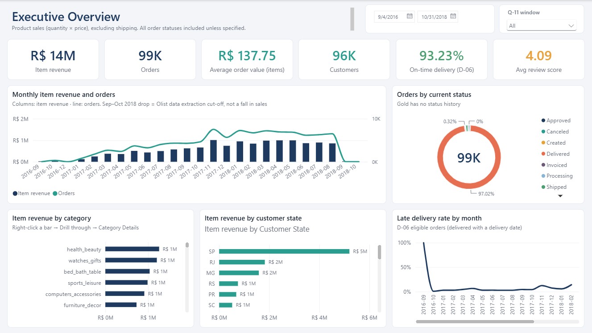
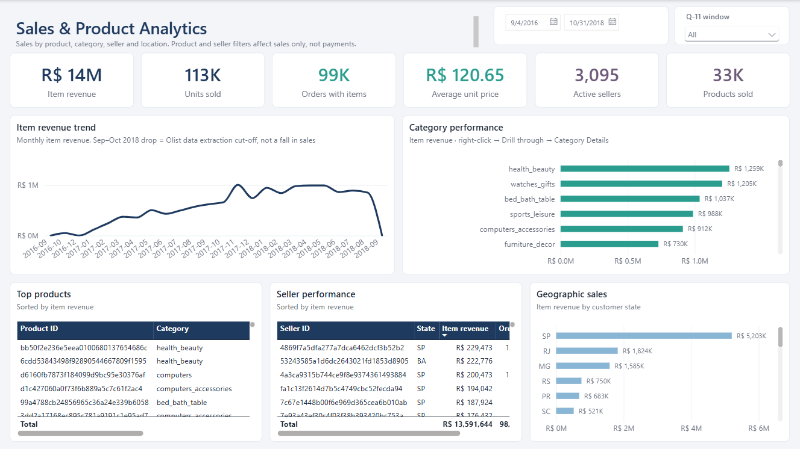
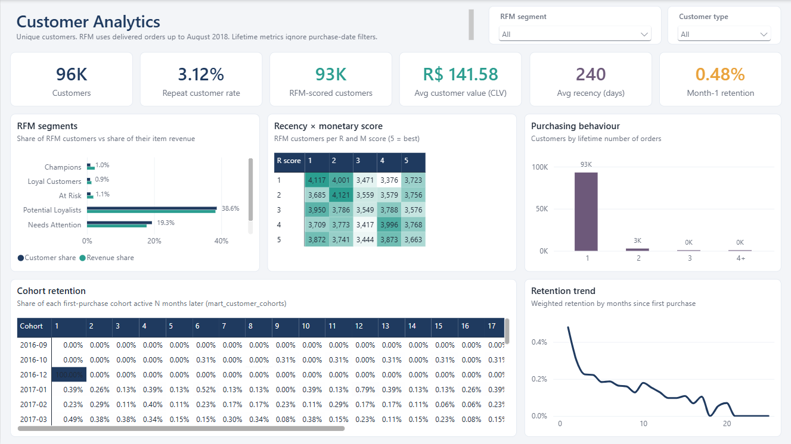
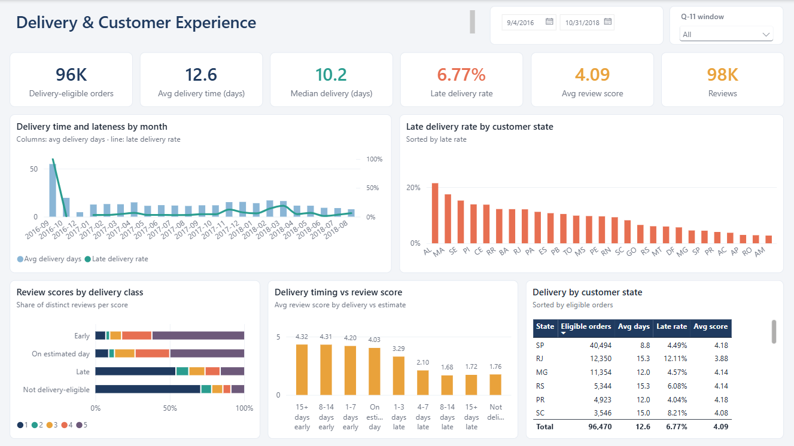
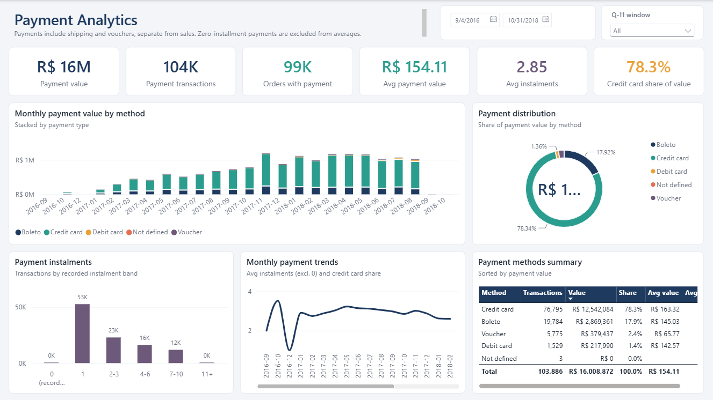
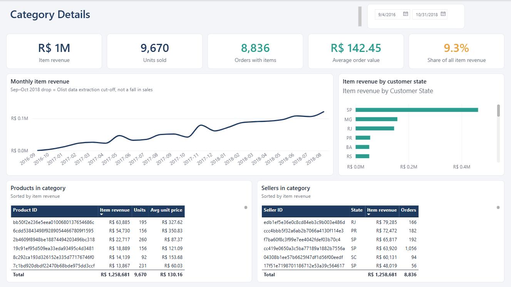

# Power BI dashboards (Phase 13)

Five interactive Power BI dashboards on the PostgreSQL warehouse, plus a category drill-through page. The report is a
**Power BI Project** (`.pbip`): a TMDL semantic model and a PBIR report, both stored as plain text so changes can be
reviewed in Git. It was built and verified with Power BI Desktop 2.159.883.0 (64-bit, October 2026).

| Page | Purpose | Main visuals |
|---|---|---|
| **Executive Overview** | Business performance at a glance | KPI cards (item revenue, orders, AOV, customers, on-time delivery, review score); monthly item revenue and orders; orders by status; revenue by category and customer state; monthly late-delivery rate |
| **Sales & Product Analytics** | Products, categories, sellers and geography | KPI cards; revenue trend; category performance; top products; seller performance; revenue by customer state |
| **Customer Analytics** | RFM, behaviour, value and retention | KPI cards (customers, repeat rate, CLV, recency, month-1 retention); RFM segments (customer vs revenue share); recency × monetary grid; customers by order count; cohort retention heatmap; retention curve |
| **Delivery & Customer Experience** | Delivery performance and its link to reviews | KPI cards (eligible orders, average and median delivery days, late rate, review score, reviews); delivery time and lateness by month; late rate by state; review-score mix by delivery class; average score by delivery timing; delivery table by state |
| **Payment Analytics** | Methods, instalments and trends | KPI cards; monthly payment value by method; payment distribution; transactions by instalment band; monthly instalments; payment-method summary |
| *Category Details* (drill-through, hidden) | One category in detail | KPI cards; monthly revenue; revenue by state; products and sellers in the category |

**Interaction:**
- **Slicers:** the purchase-date range and the Q-11 analysis-window slicer are synced across the Executive, Sales, Delivery and Payment pages. The Customer Analytics page has RFM-segment and customer-type slicers instead, because its customer views are lifetime or snapshot views that the purchase date doesn't filter.
- **Drill-through:** right-click any category bar on the Executive or Sales page and choose **Drill through → Category Details**.
- **Cross-filtering:** clicking a data point filters the other visuals on the page.

## Screenshots

| | |
|---|---|
|  |  |
|  |  |
|  |  |

## Files

```
dashboards/
├── RetailIntelligence.pbip                 # open this file in Power BI Desktop
├── RetailIntelligence.SemanticModel/
│   └── definition/                         # TMDL: model, relationships, parameters, one file per table
│       ├── model.tmdl  database.tmdl  relationships.tmdl  expressions.tmdl
│       └── tables/  Date · Customers · Products · Sellers · Orders · Order Lines · Payments · Reviews ·
│                    Customer Cohorts · Key Measures (.tmdl)
├── RetailIntelligence.Report/
│   ├── definition/                         # PBIR: report.json, pages/<page>/page.json, visuals/<visual>/visual.json
│   └── StaticResources/RegisteredResources/RetailIntelligenceTheme.json   # colour palette and visual styles
├── screenshots/
└── .gitignore                              # excludes .pbi/cache.abf (imported data) and .pbi/localSettings.json
```

No credentials are stored in any file. The connection settings are Power Query parameters (`ServerName`
= `localhost:5432`, `DatabaseName` = `retail_intelligence`, `RfmReferenceDate` = `2018-08-31`). Power BI Desktop keeps
the password in its own local credential store.

## Opening and refreshing

**Prerequisites:**
- Power BI Desktop (64-bit).
- The PostgreSQL warehouse loaded and the dbt marts built (see the main README).
- The read-only login `powerbi_reader` with a password set.

1. Open `dashboards/RetailIntelligence.pbip`.
2. Click **Home → Refresh**. On the first refresh, Desktop asks three things:
   - **Credentials** for `localhost:5432;retail_intelligence`: choose the **Database** tab and enter `powerbi_reader` and its password.
   - **Encryption:** the local server has SSL off, so accept the unencrypted connection. The connection never leaves this machine.
   - **Native query:** allow it to run. This is the approved `customer_rfm` query that loads the Customers table.
3. The refresh imports about 538,000 rows into 9 data tables.

**Notes:**
- Desktop creates `.pbi/cache.abf` with the imported data next to the model. It's git-ignored and never committed.
- To refresh after a pipeline run, rebuild the warehouse and dbt marts (or run the Airflow DAG), then click **Refresh** again.
- The report is Desktop-only: no Power BI Service publishing, gateway or scheduled refresh.

### Database access

`powerbi_reader` is a dedicated login. Its permissions:
- **Can log in:** yes, with a SCRAM-SHA-256 password, set interactively and never stored in the project.
- **Superuser, create-database or create-role rights:** none.
- **Read-only by default:** `default_transaction_read_only = on`.
- **Database:** CONNECT only, with no CREATE or TEMP.
- **Tables:** SELECT only, on the `warehouse` (9 tables), `analytics` (7 views) and `dbt_marts` (5 tables) schemas. `dbt_staging` isn't granted.
- **Future tables:** default privileges keep tables that dbt rebuilds readable.
- **Owns nothing:** no objects or schemas.
- **Connection limit:** 20, because Desktop loads tables in parallel.

## Data model

Import mode, star schema. Every relationship is many-to-one with single-direction filtering:

```
            Date (1) ─────────┐                    ┌──── (*) Order Lines (*) ──── (1) Products
                              ▼                    │                (*)
   Customers (1) ──────► (*) Orders (1) ───────────┤                 └────────── (1) Sellers
                                                   ├──── (*) Payments
                                                   └──── (*) Reviews

   Customer Cohorts   (dbt mart; disconnected by design)       Key Measures   (61 measures, no data)
```

| Table | Source | Grain | Rows |
|---|---|---|---|
| Date | `warehouse.dim_dates` (to 2018-10-31) | day | 788 |
| Customers | `warehouse.dim_customers` + approved `customer_rfm` query (delivered scope, as of 2018-08-31) + Phase 9 segment rules | person (`customer_unique_id`, D-01) | 96,096 |
| Products | `warehouse.dim_products` | product | 32,951 |
| Sellers | `warehouse.dim_sellers` | seller | 3,095 |
| Orders | `warehouse.fact_orders` | order | 99,441 |
| Order Lines | `warehouse.fact_order_lines` | order line (D-15) | 102,425 |
| Payments | `warehouse.fact_payments` | payment transaction | 103,886 |
| Reviews | `warehouse.fact_reviews` | review-order link | 99,224 |
| Customer Cohorts | `dbt_marts.mart_customer_cohorts` | cohort month × months since first purchase | 327 |

**Design choices:**
- **Orders is the hub.** Date and Customers filter Orders, and Orders filters Order Lines, Payments and Reviews. Products and Sellers filter Order Lines only.
- **No fan-out.** Item revenue, payments and reviews never share a filter path through order lines, so no fact is ever joined to another one.
- **Reuse, not rebuild.** The model reuses the warehouse star schema, the cohort mart and the approved RFM query. The analytics views and the other dbt marts serve as the validation reference (see *Validation*).
- **Added columns are labels only.** The few columns added in Power Query are sort orders, readable labels, the D-06 eligibility flag and the delivery class, the last one defined exactly as in `mart_review_scores_by_delivery`.

### Business rules applied

| Rule | How the model applies it |
|---|---|
| **Q-03** item revenue vs payment value | Item revenue comes only from Order Lines (quantity × unit price, freight excluded). Payment value comes only from Payments (it includes freight and vouchers). No measure adds, subtracts or divides one by the other. Product and seller filters never reach Payments. |
| **D-01** person | Customers are `customer_unique_id`. Customer counts are distinct persons. |
| **D-06** delivery eligibility | Delivery measures use orders with status `delivered` **and** a customer delivery date (96,470 orders). Durations are averaged only where defined (D-08). Lateness is day-level. |
| **Q-04 / D-07** reviews | Reviews stay at review-order-link grain. Review counts are distinct `review_id`. The average score is over distinct reviews, and no order-level score is derived. |
| **D-16** zero instalments | The 2 zero-instalment payments are kept, shown as their own band and excluded from the instalment average. Zero-value payments are excluded from the average payment value. |
| **Q-11** analysis window | A slicer, not a default filter. The Sep–Oct 2018 drop in the trend charts is the dataset's extraction cut-off: 20 orders, 19 of them canceled. |

## DAX measures

All 61 measures live in the **Key Measures** table, grouped in display folders. (The table can't be named "Measures",
because Power BI reserves that name.)

**Sales** (12)

| Measure | DAX | Format | Definition |
|---|---|---|---|
| Item Revenue | `SUM('Order Lines'[Line Price Total])` | `R$ #,0` | Item-based revenue: sum of line price totals (quantity x unit price), freight excluded (Q-03). |
| Item Revenue (Delivered) | `CALCULATE([Item Revenue], Orders[Order Status Code] = "delivered")` | `R$ #,0` | Item revenue of orders whose current status is 'delivered'. |
| Freight Value | `SUM('Order Lines'[Freight Total])` | `R$ #,0` | Freight charged on order lines (item-based, reported separately from item revenue). |
| Units Sold | `SUM('Order Lines'[Quantity])` | `#,0` |  |
| Orders with Items | `DISTINCTCOUNT('Order Lines'[Order ID])` | `#,0` | Distinct orders that have at least one order line in the current filter context (responds to product, category and seller filters). |
| Average Order Value | `DIVIDE([Item Revenue], [Orders with Items])` | `R$ #,0.00` | Average order value (item-based): Item Revenue / Orders with Items. Freight and payments excluded. |
| Average Unit Price | `DIVIDE([Item Revenue], [Units Sold])` | `R$ #,0.00` |  |
| Active Sellers | `DISTINCTCOUNT('Order Lines'[Seller ID])` | `#,0` |  |
| Products Sold | `DISTINCTCOUNT('Order Lines'[Product ID])` | `#,0` |  |
| Item Revenue Share | `DIVIDE([Item Revenue], CALCULATE([Item Revenue], REMOVEFILTERS(Products), REMOVEFILTERS(Sellers)))` | `0.0%` | Share of item revenue across all products and sellers, keeping the other filters. |
| Item Revenue PY | `CALCULATE([Item Revenue], SAMEPERIODLASTYEAR('Date'[Date]))` | `R$ #,0` | Item revenue of the same period one year earlier (Date table). |
| Item Revenue YoY % | `VAR PY = [Item Revenue PY] RETURN IF(NOT ISBLANK(PY), DIVIDE([Item Revenue] - PY, PY))` | `+0.0%;-0.0%;0.0%` | Year-over-year change of item revenue; blank when the prior period has no revenue. |

**Orders** (10)

| Measure | DAX | Format | Definition |
|---|---|---|---|
| Total Orders | `COUNTROWS(Orders)` | `#,0` | All orders in the filter context (any status). Not affected by product or seller filters. |
| Delivered Orders | `CALCULATE([Total Orders], Orders[Order Status Code] = "delivered")` | `#,0` |  |
| Canceled Orders | `CALCULATE([Total Orders], Orders[Order Status Code] = "canceled")` | `#,0` |  |
| Cancellation Rate | `DIVIDE([Canceled Orders], [Total Orders])` | `0.00%` |  |
| Delivered Share | `DIVIDE([Delivered Orders], [Total Orders])` | `0.0%` |  |
| Purchasing Customers | `DISTINCTCOUNT(Orders[Customer ID])` | `#,0` | Distinct persons (customer_unique_id, D-01) who placed an order in the filter context. |
| New Customers | `CALCULATE(DISTINCTCOUNT(Orders[Customer ID]), Orders[Is First Order] = TRUE())` | `#,0` | Persons whose first-ever order falls in the filter context. |
| Repeat Orders | `CALCULATE([Total Orders], Orders[Customer Order Sequence] >= 2)` | `#,0` | Orders placed by persons who had ordered before (customer order sequence >= 2). |
| Repeat Order Share | `DIVIDE([Repeat Orders], [Total Orders])` | `0.00%` |  |
| Orders per Customer | `DIVIDE([Total Orders], [Purchasing Customers])` | `0.000` |  |

**Customers** (4)

| Measure | DAX | Format | Definition |
|---|---|---|---|
| Total Customers | `COUNTROWS(Customers)` | `#,0` | Persons in the customer dimension (lifetime view; not filtered by purchase date). |
| Repeat Customers | `CALCULATE([Total Customers], Customers[Customer Type] = "Repeat")` | `#,0` |  |
| Repeat Customer Rate | `DIVIDE([Repeat Customers], [Total Customers])` | `0.00%` | Share of persons with 2+ lifetime orders (any status). |
| Avg Lifetime Item Revenue | `AVERAGE(Customers[Lifetime Item Revenue])` | `R$ #,0.00` |  |

**Customers › RFM** (7)

| Measure | DAX | Format | Definition |
|---|---|---|---|
| RFM Customers | `CALCULATE([Total Customers], Customers[Has Eligible Purchase] = TRUE())` | `#,0` | Persons scored by RFM (eligible delivered purchase on or before the reference date). |
| RFM Monetary | `SUM(Customers[Monetary])` | `R$ #,0` | Historical CLV: item revenue of eligible orders up to the reference date. |
| Avg Customer Value | `DIVIDE([RFM Monetary], [RFM Customers])` | `R$ #,0.00` |  |
| Avg Recency Days | `AVERAGE(Customers[Recency Days])` | `#,0` |  |
| Avg Frequency | `AVERAGE(Customers[Frequency])` | `0.000` |  |
| Segment Customer Share | `DIVIDE([RFM Customers], CALCULATE([RFM Customers], REMOVEFILTERS(Customers[RFM Segment], Customers[RFM Segment Sort], Customers[RFM Group])))` | `0.0%` |  |
| Segment Revenue Share | `DIVIDE([RFM Monetary], CALCULATE([RFM Monetary], REMOVEFILTERS(Customers[RFM Segment], Customers[RFM Segment Sort], Customers[RFM Group])))` | `0.0%` |  |

**Customers › Cohorts** (4)

| Measure | DAX | Format | Definition |
|---|---|---|---|
| Cohort Customers | `CALCULATE(SUM('Customer Cohorts'[Cohort Size]), 'Customer Cohorts'[Months Since First Purchase] = 0)` | `#,0` | Size of the cohort(s): customers in their first-purchase month (months since first purchase = 0). |
| Retention Rate | `DIVIDE(SUM('Customer Cohorts'[Active Customers]), SUM('Customer Cohorts'[Cohort Size]))` | `0.00%` | Active customers / cohort size, weighted across the cohorts in context (mart_customer_cohorts). |
| Month-1 Retention | `CALCULATE([Retention Rate], 'Customer Cohorts'[Months Since First Purchase] = 1)` | `0.00%` | Retention one month after the first purchase. |
| Retention Rate (after month 0) | `CALCULATE([Retention Rate], 'Customer Cohorts'[Months Since First Purchase] >= 1)` | `0.00%` | Retention rate excluding month 0 (always 100%), for the retention curve. |

**Delivery** (9)

| Measure | DAX | Format | Definition |
|---|---|---|---|
| Delivery-Eligible Orders | `CALCULATE([Total Orders], Orders[Delivery Eligible] = TRUE())` | `#,0` | D-06 eligible orders: status delivered with a customer delivery date. |
| Late Orders | `CALCULATE([Total Orders], Orders[Delivery Eligible] = TRUE(), Orders[Is Late] = TRUE())` | `#,0` |  |
| Late Delivery Rate | `DIVIDE([Late Orders], [Delivery-Eligible Orders])` | `0.00%` | Late eligible orders / eligible orders (day-level lateness, as analytics.delivery_monthly). |
| On-Time Delivery Rate | `DIVIDE([Delivery-Eligible Orders] - [Late Orders], [Delivery-Eligible Orders])` | `0.00%` |  |
| Avg Delivery Days | `CALCULATE(AVERAGE(Orders[Purchase to Delivery Days]), Orders[Delivery Eligible] = TRUE())` | `0.0` | Mean purchase-to-delivery days over eligible orders where the duration is defined (D-08). |
| Median Delivery Days | `CALCULATE(MEDIAN(Orders[Purchase to Delivery Days]), Orders[Delivery Eligible] = TRUE())` | `0.0` |  |
| Avg Carrier to Customer Days | `CALCULATE(AVERAGE(Orders[Carrier to Customer Days]), Orders[Delivery Eligible] = TRUE())` | `0.0` |  |
| Avg Days vs Estimate | `CALCULATE(AVERAGE(Orders[Delivery vs Estimate Days]), Orders[Delivery Eligible] = TRUE())` | `+0.0;-0.0;0.0` | Mean (delivery date - estimated date) in days over eligible orders; negative = delivered early. |
| Avg Approval Hours | `CALCULATE(AVERAGE(Orders[Approval Hours]), Orders[Delivery Eligible] = TRUE())` | `0.0` |  |

**Reviews** (6)

| Measure | DAX | Format | Definition |
|---|---|---|---|
| Review Count | `DISTINCTCOUNT(Reviews[Review ID])` | `#,0` | Distinct reviews (review_id). A review shared by several orders counts once (Q-04 / D-07). |
| Review Links | `COUNTROWS(Reviews)` | `#,0` | Review-order links (rows of the review fact). |
| Avg Review Score | `AVERAGEX(VALUES(Reviews[Review ID]), CALCULATE(MAX(Reviews[Review Score])))` | `0.00` | Mean score over distinct reviews in context (each review counted once with its own score). This is a review-level average, not an order-level review score (Q-04). |
| 5-Star Review Share | `DIVIDE(CALCULATE([Review Count], Reviews[Review Score] = 5), [Review Count])` | `0.0%` |  |
| Low Score Share (1-2) | `DIVIDE(CALCULATE([Review Count], Reviews[Review Score] <= 2), [Review Count])` | `0.0%` | Share of reviews scored 1 or 2. |
| Review Score Share | `DIVIDE([Review Count], CALCULATE([Review Count], REMOVEFILTERS(Reviews[Review Score])))` | `0.0%` | Share of a score within the reviews in context (as review_share_pct in mart_review_scores_by_delivery). |

**Payments** (9)

| Measure | DAX | Format | Definition |
|---|---|---|---|
| Payment Value | `SUM(Payments[Payment Value])` | `R$ #,0` | Payment-based value: sum of payment transactions (includes freight and vouchers; Q-03). |
| Payment Transactions | `COUNTROWS(Payments)` | `#,0` |  |
| Orders with Payment | `DISTINCTCOUNT(Payments[Order ID])` | `#,0` |  |
| Avg Payment Value | `CALCULATE(AVERAGE(Payments[Payment Value]), Payments[Zero Value Payment] = FALSE())` | `R$ #,0.00` | Average transaction value excluding zero-value payments (as mart_payment_installments). |
| Payment Value per Order | `DIVIDE([Payment Value], [Orders with Payment])` | `R$ #,0.00` |  |
| Avg Installments | `CALCULATE(AVERAGE(Payments[Installments]), Payments[Zero Installments] = FALSE())` | `0.00` | Average instalments excluding the 0-instalment rows (D-16, as mart_payment_methods_monthly). |
| Payment Value Share | `DIVIDE([Payment Value], CALCULATE([Payment Value], REMOVEFILTERS(Payments[Payment Type], Payments[Payment Type Code])))` | `0.0%` | Share of payment value across payment types, keeping the other filters. |
| Credit Card Value Share | `DIVIDE(CALCULATE([Payment Value], Payments[Payment Type Code] = "credit_card"), CALCULATE([Payment Value], REMOVEFILTERS(Payments[Payment Type], Payments[Payment Type Code])))` | `0.0%` |  |
| Multi-Installment Share | `DIVIDE(CALCULATE([Payment Transactions], Payments[Installments] >= 2), [Payment Transactions])` | `0.0%` |  |


## Validation

With the refreshed model open in Desktop, DAX queries run through the local Analysis Services engine (ADOMD) were
compared with SQL on PostgreSQL:

| Check | Reference | Result |
|---|---|---|
| Headline KPIs (30 measures) | warehouse tables | match: item revenue R$13,591,643.70, payment value R$16,008,872.12, 99,441 orders, 98,666 orders with items, AOV R$137.75, 96,096 customers, 96,470 eligible / 6,534 late orders, 98,410 reviews (avg 4.0888), 93,293 RFM customers |
| Monthly sales and payments (25 months) | `analytics.sales_daily` | match |
| Categories (74), sellers (3,095), products (32,951) | `analytics.category_/seller_/product_performance` | match |
| Delivery by month (25) and state (27) | `analytics.delivery_monthly`, `delivery_by_state` | match (counts exact; rates and days to the view's rounding) |
| Review score by delivery class (20 rows) | `dbt_marts.mart_review_scores_by_delivery` | match |
| Payment methods by month (90) and instalments (28) | `dbt_marts.mart_payment_methods_monthly`, `mart_payment_installments` | match |
| Cohort retention (327 cells) | `dbt_marts.mart_customer_cohorts` | match |
| RFM segments (8) | `customer_rfm` + Phase 9 rules | match: 930 / 872 / 997 / 36,057 / 18,046 / 36,391 |
| Slicers and drill-through | SQL with the same filters | match: date range, Q-11 window, category drill-through (alone and combined with the date range), RFM segment |

Two differences are expected and harmless:
- **Money ratios:** AOV and average payment value use Power BI's fixed decimal type (4 decimal places). For example, AOV is 137.7541 vs 137.754076 in SQL.
- **Empty months:** DAX shows blank where SQL shows 0.

## Limitations

- **RFM is a snapshot.** RFM and segments are as of 2018-08-31 and don't react to the date slicer. The segment rules are documented analysis definitions, not approved business KPIs (Phase 9).
- **Current status only.** Order status is the status at data extraction, because Gold has no status history.
- **Lifetime views.** The customer dimension shows lifetime values. Date-sensitive customer counts use *Purchasing Customers* and *New Customers* (from Orders).
- **No maps.** Map visuals were deliberately not used (they depend on online map services and tenant settings). Geography is shown with state charts.
