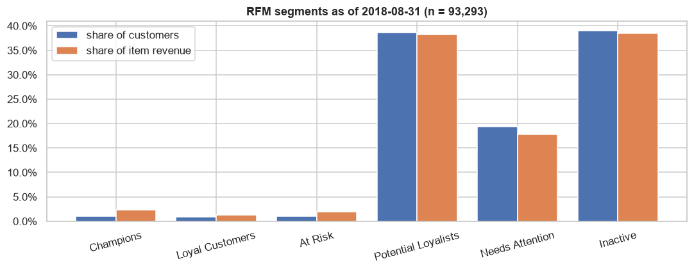
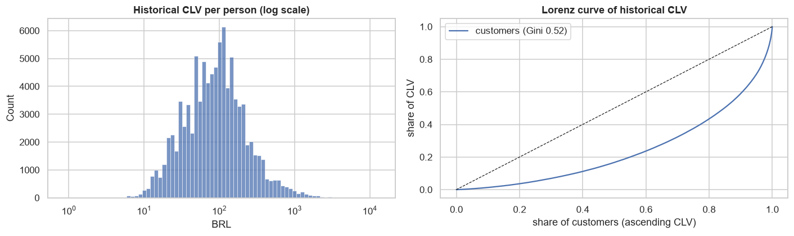
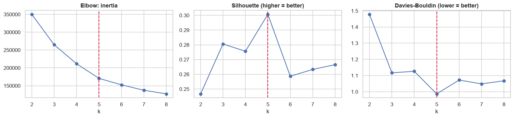
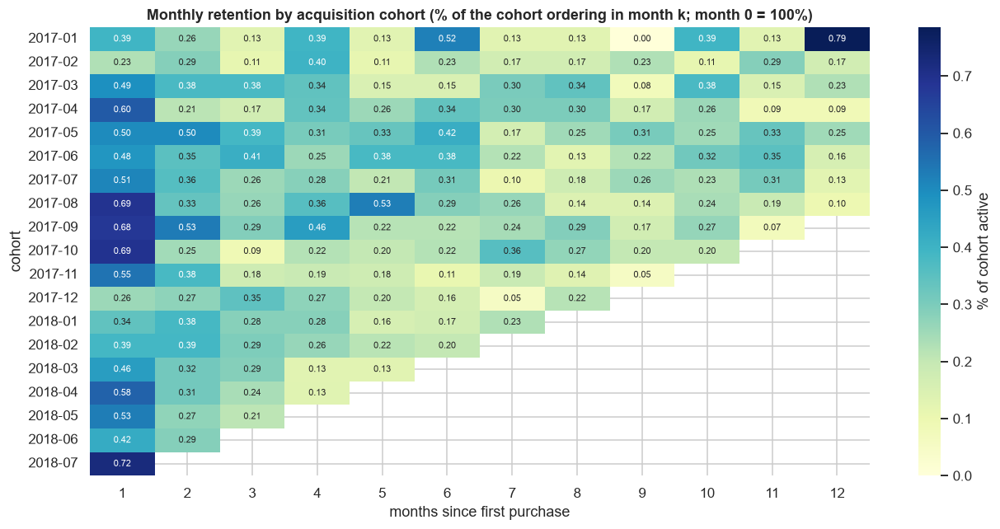
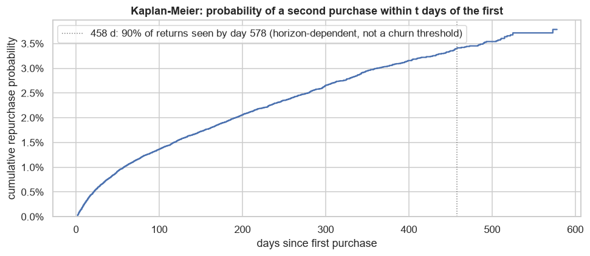

# Customer Analytics (Phase 9)

**Notebooks:**
- `notebooks/06_customer_behavior_rfm.ipynb`: purchasing behaviour, RFM and historical CLV.
- `notebooks/07_customer_segmentation_retention.ipynb`: K-Means, cohort retention and inactivity.

**Data:** Gold `dim_customers` and `fact_orders`, plus the approved SQL queries `repeat_customer_analysis`, `interpurchase_intervals` and `customer_rfm`, and the dbt mart `mart_customer_cohorts`. All are reused, none is rebuilt.
**Environment:** project `.venv` (pandas, NumPy, scikit-learn 1.9, Matplotlib, Seaborn); no new dependencies. The notebooks need the project PostgreSQL database.

## Methodology
| Area | Approach |
|---|---|
| Customer identity | `customer_unique_id` (D-01); money = item revenue, excluding freight and never mixed with payments (Q-03); every person-level figure is aggregated once per person from order-grain data (no fan-out) |
| Reference date | **2018-08-31**, the end of the Q-11 window. Later months hold 20 orders, so a later date would distort recency |
| RFM | The approved `customer_rfm` query (delivered scope; tie-aware scores `1 + floor(5 · percent_rank)`), **independently recomputed in pandas: exact match** for all 93,293 people |
| RFM segments | Frequency is effectively binary (97% have one order), so segments use repeat status first, then R and M scores (table below). There is no "Lost" segment |
| CLV | Historical item revenue of delivered orders up to the reference date. Predictive CLV (BG/NBD, Gamma-Gamma) isn't defensible here: 97% have no repeat purchase, the repeat rate is 3%, and there is no margin data |
| K-Means | 5 features per person (log recency, log frequency, log monetary, freight share, log instalments), standardised. k = 2–8 assessed by inertia, silhouette (15,000 sample) and Davies–Bouldin; seed stability; comparison with RFM by adjusted Rand index |
| Cohorts | The dbt mart read from PostgreSQL and **validated cell by cell** against an independent Gold computation |
| Inactivity | Kaplan–Meier time from first to second purchase (≥ 1 day later), right-censored at the reference date (no leakage); conditional return probabilities |

**RFM segment rules** (R = recency score, M = monetary score):

| Segment | Rule |
|---|---|
| Champions | 2+ orders, R ≥ 4, M ≥ 4 |
| Loyal Customers | 2+ orders, R ≥ 3, not Champions |
| At Risk | 2+ orders, R ≤ 2 |
| Potential Loyalists | 1 order, R ≥ 4 |
| Needs Attention | 1 order, R = 3 |
| Inactive | 1 order, R ≤ 2 |

R score boundaries in days since the last purchase: 5 = 2–93, 4 = 94–178, 3 = 179–269, 2 = 270–383, 1 = 384–715.

## Validation
- **Counts:** Gold `dim_customers` (96,096) and `fact_orders` (99,441) equal the PostgreSQL warehouse, including total item revenue (13,591,643.70 BRL).
- **Identity:** customer ids are unique, every order maps to a person, and Σ `n_orders` = the number of orders.
- **Reused queries:** the repeat-customer count matches Gold, and the interpurchase statistics match their query.
- **RFM:** R, F, M and all scores equal an independent recomputation. That recomputation found and documented a float-rounding subtlety: totals must be rounded to cents to reproduce SQL ties.
- **Segments:** exhaustive and mutually exclusive (asserted); their totals reproduce the population and revenue.
- **CLV:** the totals equal an independent sum of the same orders, with one value per person.
- **K-Means:** k = 5 is supported by two criteria, and the adjusted Rand index is ≥ 0.991 across seeds.
- **dbt cohort mart:** all 225 non-empty cells (active customers, orders, revenue), the cohort sizes, the retention percentages and the cohort months match exactly.
- **Execution:** both notebooks run top to bottom without errors or warnings.

## Key findings

1. **Repeat buying is rare.**
   - 1.035 orders per customer.
   - 3.12% repeat customers, generating 5.73% of item revenue.
   - Repeat customers spend 1.9× as much, but they're too few to carry the business.
2. **When repurchase happens, it's soon:** a median of 38 days between purchases, with 46% within 30 days.
3. **RFM:**
   - The repeat segments (Champions 930, Loyal Customers 872, At Risk 997) are 3.0% of customers and 5.5% of revenue.
   - The one-time segments split by recency: **Potential Loyalists 36,057**, Needs Attention 18,046, Inactive 36,391.
4. **CLV is concentrated in large first baskets, not in loyalty.**
   - Gini 0.52; the top 5% hold 29.1% of value (median 649 BRL).
   - Only 8.5% of that top 5% are repeat buyers, and about 92% fall in one-time segments.

   
5. **K-Means (k = 5, silhouette 0.30: moderate structure).**
   - **High-value instalment buyers:** 24% of customers, **45% of revenue** (median 170 BRL, 6 instalments).
   - **Mid-value single-payment buyers:** 37% of customers, 34% of revenue.
   - **Recent first-time buyers:** 14%.
   - **Repeat buyers:** 3%.
   - **Low-value, freight-heavy buyers:** 22% of customers but 5% of revenue; freight is 36% of their order value.

   It agrees with RFM on repeat buyers and otherwise splits by value and payment rather than recency (adjusted Rand index 0.09). The two are complementary.

   
6. **Cohort retention is very low and flat.**
   - Pooled month-1 retention is 0.51%, then 0.2–0.3% per month.
   - Month-1 retention varies little by cohort (0.23–0.72%).

   
7. **No defensible churn label.**
   - The probability of a second purchase rises steadily (1.9% within 180 days, 3.0% within a year, 3.8% by day 578) with **no plateau**.
   - Inactivity lowers the chance of returning in the next 180 days only gradually (1.9% → 0.7% after a year).
   - Even new customers are 98% likely not to return within 180 days, so "churn" would just reproduce the base rate.
   - What can be reported are inactivity shares: 59.9% of customers have no purchase for over 180 days, and 22.8% for over a year.

   

## Recommendations
1. **Focus on the second purchase, in the first weeks.**
   - The return probability is highest right after the first order, so post-delivery engagement for **Potential Loyalists** beats generic loyalty programmes.
   - Measure the effect with a randomised holdout. Notebook 05's power analysis shows how to size it.
2. **Protect the instalment-driven revenue.** A quarter of customers, buying on 6 instalments, bring 45% of revenue, so credit terms and instalment availability are commercially central.
3. **Address freight-heavy small baskets** (22% of customers) with free-shipping thresholds or bundling, which may also lift basket size.
4. **Run a targeted win-back for At Risk** (997 proven repeat buyers gone quiet), not a mass campaign aimed at "Inactive" one-time buyers.
5. **Don't build a churn model** on this data. Track inactivity shares and second-purchase rates by cohort instead.

## Limitations
- **Observational data:** segments and clusters are descriptive, not causal.
- **Scope of RFM and CLV:** as of 2018-08-31, delivered scope, using current order status (Gold has no status history). Monetary values are revenue, not margin.
- **Segment rules and cluster names** are documented analysis definitions, not approved business KPIs.
- **K-Means:** the partition depends on the chosen features, and its borders are soft (silhouette 0.30).
- **Populations differ by design:** cohorts and inactivity use all orders of any status (96,090 people, the mart's definition), while RFM, CLV and K-Means use the delivered scope (93,293).
- **Kaplan–Meier:** it covers the first-to-second purchase only. About 20 months of data limits precision at long horizons, and same-day orders are treated as split baskets (Q-09).
