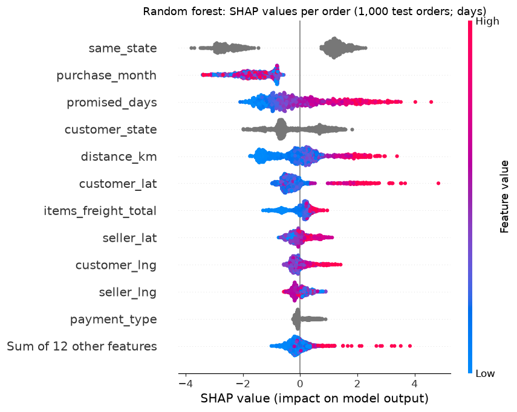
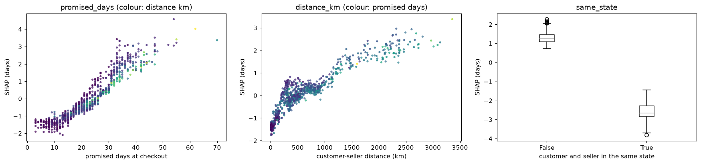
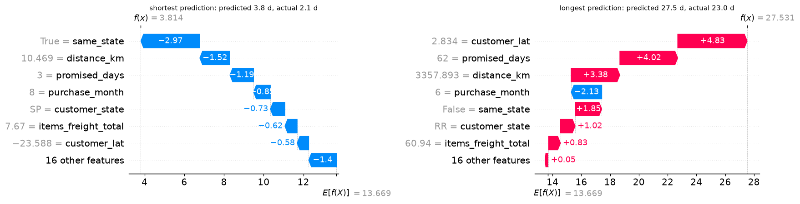
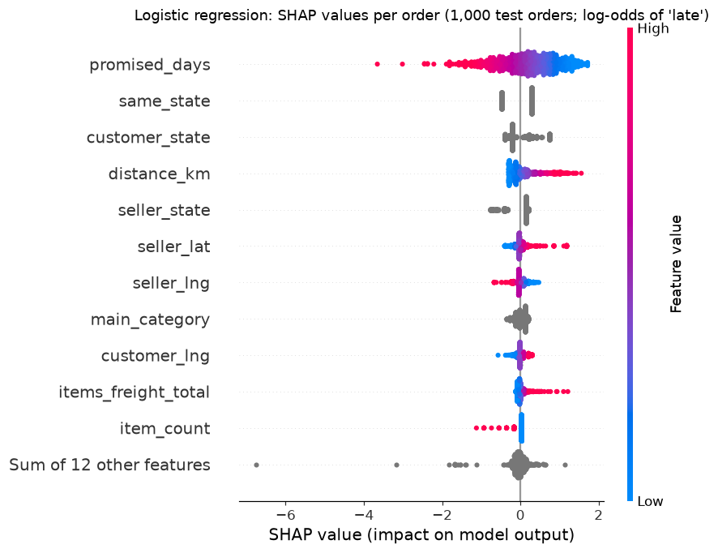
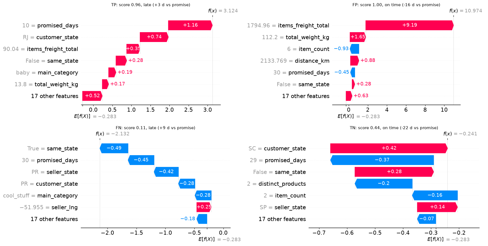

# Explainable AI: SHAP Explanations of the Delivery Models (Phase 12)

**Notebook:** `notebooks/11_model_explainability.ipynb` (executed top to bottom: 0 errors, 0 warnings).
**Models explained:** the two Phase 10 models selected on time-series cross-validation:
- the **random forest** predicting delivery time in days (notebook 08);
- the **logistic regression** scoring late-delivery risk (notebook 09).

**Dependency:** `shap==0.54.1`, added with `slicer` and `tqdm`; no other package changed.

## 1. Why SHAP
Phase 10's permutation importance shows which features the models **need for test performance**, but not **how each feature moves an individual prediction**. SHAP (Shapley additive explanations) splits each prediction into a baseline plus one contribution per feature. The contributions **add up exactly to the model's output**, so one consistent method gives both **global** importance (average size of the contributions) and **local** explanations (one order's contributions). Exact algorithms exist for both model types used here, so no approximation is needed.

## 2. Methodology
**Reconstruction.** The Phase 10 models weren't saved to disk. They were rebuilt from their recorded configurations: the same checkout-time features (`src/ml/delivery_features.py`), the same temporal split (development 2017-01 to 2018-04, 70,851 orders; test 2018-05 to 2018-08, 25,352 orders), preprocessing, hyperparameters and seed. **Before any explanation, the rebuilt models must reproduce the recorded Phase 10 test results:**

| Metric | Recorded (Phase 10) | Rebuilt | Match |
|---|---:|---:|:-:|
| Random forest test MAE | 4.3650 | 4.3651 | yes |
| Random forest test RMSE | 5.9230 | 5.9227 | yes |
| Random forest test R² | 0.1930 | 0.1930 | yes |
| Logistic regression test PR-AUC | 0.0883 | 0.0883 | yes |
| Logistic regression test ROC-AUC | 0.7032 | 0.7032 | yes |

No model was selected or tuned again. The logistic regression is explained because it won on cross-validation, even though gradient boosting scored better on the test set.

**Explainers:**

| Model | Explainer | Background | Output explained |
|---|---|---|---|
| Random forest | **TreeSHAP** (`shap.TreeExplainer`, exact, `tree_path_dependent`) | none: uses the trees' own training statistics | predicted delivery days |
| Logistic regression | **LinearSHAP** (`shap.LinearExplainer`, independent masker) | 500 orders sampled from **development** data (never test) | log-odds of "late" (the decision function) |

- **One-hot features:** SHAP values of each categorical's one-hot columns are **summed into the original feature**, so explanations use the 23 Phase 10 checkout-time features. Summing preserves additivity (checked).
- **Explained population:** a reproducible random sample of **1,000 test-period orders** (seed 42). Its late rate is 4.30% (test 4.40%) and its median delivery time 8.0 days (7.8). Explaining existing test predictions fits or tunes nothing.
- **Interactions:** exact TreeSHAP interaction values weren't computed. They cost about one extra full SHAP pass per input column: 111 preprocessed columns (counted from the fitted preprocessing; the notebook describes it as "about 100") on 200 depth-20 trees. The main interaction is shown through coloured dependence plots instead.

## 3. Verification
| Check | Result |
|---|---|
| Random forest additivity: base + Σ SHAP = prediction | max deviation **2.52e-13** (base value 13.669 days) |
| Logistic regression additivity: base + Σ SHAP = decision function | max deviation **2.22e-15** (base value −0.283 log-odds) |
| Logistic regression closed form: SHAP = coef × (x − background mean) | max deviation **0.00e+00** |
| Feature mapping | every preprocessed column is mapped to exactly one of the 23 features; grouping preserves the row sums |
| Leakage | no feature on the Phase 10 leakage list; the background is development data only |
| Reproducibility | the same seed gives the same sample and identical SHAP values on recomputation |

## 4. Regression: delivery time (random forest)
**Global importance** (mean |SHAP| over 1,000 test orders, in days), next to the recorded Phase 10 permutation importance (increase in test MAE):

| Feature | Mean \|SHAP\| (days) | SHAP rank | Permutation (MAE increase) | Permutation rank |
|---|---:|---:|---:|---:|
| same_state | 1.7926 | 1 | 0.1610 | 2 |
| purchase_month | 1.5317 | 2 | – (not in top 10) | – |
| promised_days | 1.0094 | 3 | 0.3430 | 1 |
| customer_state | 0.7511 | 4 | – | – |
| distance_km | 0.7419 | 5 | 0.1520 | 3 |
| customer_lat | 0.5682 | 6 | 0.0940 | 4 |
| items_freight_total | 0.2911 | 7 | – | – |
| seller_lat | 0.2658 | 8 | 0.0240 | 8 |
| customer_lng | 0.2389 | 9 | 0.0650 | 5 |
| seller_lng | 0.1946 | 10 | 0.0570 | 6 |

**Agreement:** 7 of the top 10 features are shared, with a Spearman rank correlation of 0.84 on shared features. Two differences are informative:
- **`purchase_month`** is the 2nd-largest SHAP influence but not in the permutation top 10. In the test months (May–August) it pulls every prediction down (see the beeswarm): the forest learned month effects from earlier periods and uses them strongly, but they add little accuracy in May–August 2018. **A large attribution doesn't mean a useful one under temporal drift.**
- **`customer_state`** ranks 4th in SHAP but is absent from the permutation top 10. It's correlated with the customer coordinates: shuffling one of several correlated features costs little accuracy, while SHAP divides their joint effect among them.

**Dependence:**
- **Same state:** same-state orders have a mean SHAP of **−2.57 days**, cross-state orders **+1.29 days**.
- **Promise:** the SHAP value of `promised_days` rises almost monotonically with the promise (correlation 0.94). Olist's promise already encodes route difficulty.
- **Distance** adds days on long routes, and the colouring shows that long distances usually come with long promises. These overlapping features are the main interaction.

**Local explanations** (base value 13.669 days):

| Order | Route | Prediction | Actual | Largest contributions (days) |
|---|---|---:|---:|---|
| Shortest prediction | SP → SP, 10 km, promise 3 days | 3.8 | 2.1 | same_state −2.97, distance −1.52, promise −1.19, month −0.85 |
| Longest prediction | SP → RR, 3,358 km, promise 62 days | 27.5 | 23.0 | customer latitude +4.83, promise +4.02, distance +3.38, month −2.13, same_state +1.85 |

## 5. Classification: late-delivery risk (logistic regression)
**Global importance** (mean |SHAP| in log-odds), next to the recorded Phase 10 permutation importance (drop in test PR-AUC):

| Feature | Mean \|SHAP\| (log-odds) | SHAP rank | Permutation (PR-AUC drop) | Permutation rank |
|---|---:|---:|---:|---:|
| promised_days | 0.6600 | 1 | 0.0393 | 1 |
| same_state | 0.3621 | 2 | – (not in top 10) | – |
| customer_state | 0.2938 | 3 | 0.0028 | 4.5 |
| distance_km | 0.2439 | 4 | 0.0044 | 3 |
| seller_state | 0.2238 | 5 | 0.0028 | 4.5 |
| seller_lat | 0.0953 | 6 | 0.0069 | 2 |
| seller_lng | 0.0886 | 7 | – | – |
| main_category | 0.0868 | 8 | – | – |
| customer_lng | 0.0739 | 9 | 0.0006 | 10 |
| items_freight_total | 0.0655 | 10 | – | – |

**Agreement:** 6 of the top 10 features are shared, with a Spearman rank correlation of 0.71 on shared features. Both methods put the **promise first**. The location features (same state, states, coordinates, distance) are correlated, and the two methods divide their importance differently.

**Direction** (largest standardised coefficients, log-odds per standard deviation):
- **promised days −0.622:** a longer promise means lower late risk;
- **distance +0.328:** a longer distance means higher risk;
- smaller effects: distinct sellers −0.164, seller latitude +0.145, purchase month −0.140, seller longitude −0.126.

Because of `class_weight="balanced"`, the scores are **risk rankings, not calibrated probabilities**.

**Local explanations at the Phase 10 operating point.** The threshold is the 90th percentile of test scores (0.717) and flags 10.0% of orders: **262 TP, 2,274 FP, 853 FN, 21,963 TN**. That's precision 10.3% (262 / 2,536) and recall 23.5% (262 / 1,115), computed from these counts and consistent with Phase 10.

| Case | Order | Score (log-odds) | Largest contributions (log-odds) | Reading |
|---|---|---|---|---|
| **TP** | SP → RJ, 625 km, promise 10 days, delivered in 13.5 days | 0.958 (3.12) | promise +1.16, customer_state +0.74, freight +0.35, same_state +0.28 | short promise on a cross-state route: correctly flagged |
| **FP** | SP → PB, 2,134 km, promise 30 days, delivered in 13.8 days, **freight 1,794.96 BRL** | 1.000 (10.97) | **freight +9.19**, weight +1.65, item_count −0.93, distance +0.88 | out-of-range freight extrapolated by a linear model |
| **FN** | PR → PR, 353 km, promise 30 days, delivered in 38.5 days | 0.106 (−2.13) | same_state −0.49, promise −0.45, seller_state −0.42, customer_state −0.28 | looked low-risk at checkout; the delay arose later |
| **TN** | SP → SC, 582 km, promise 29 days, delivered in 7.0 days | 0.440 (−0.24) | customer_state +0.42, promise −0.37, same_state +0.28 | risk factors offset by a long promise |

**The false positive exposes a model weakness.** The order's freight of 1,794.96 BRL is **above the largest freight in the development data (1,002.29 BRL; median 16.79, p99 98.98)**. The freight coefficient is small (+0.105 log-odds per SD), but this value lies far outside the training range, so the linear model extrapolates to a near-certain score.

## 6. Model attribution, correlation and causation
These three are **not interchangeable**:
- **Model attribution (SHAP):** how much each feature contributed to *this model's prediction*. It's exact for these models, and that's all it claims.
- **Correlation:** the models learned **statistical associations** from historical, observational data. A feature can receive a large attribution because it travels with the real cause. The promise, for example, summarises route difficulty that Olist already knew.
- **Causation:** what would happen if a feature were *changed*. Neither SHAP nor permutation importance answers this. For example, a SHAP value of −2.57 days for "same state" doesn't mean that moving sellers into the customer's state would cut delivery by 2.6 days. Causal claims would need experiments or causal designs.

**Permutation importance (Phase 10)** answers a third question again: how much *test performance* depends on a feature. That's why it can disagree with SHAP under drift (`purchase_month`) and with correlated features (`customer_state`).

## 7. Findings and business interpretation
1. **Both models reason in logistics terms:** route (same state, distance, region) and the promise. Predictions can be explained to operations and customer service in plain route language.
2. **The promise works in opposite directions in the two models.** In the regression a long promise signals a slow route (more predicted days); in the classification it signals slack (lower late risk). Both reflect historical correlations, not the effect of changing the promise.
3. **Local explanations reveal risks that aggregate metrics hide:**
   - **Out-of-range inputs** (the 1,794.96 BRL freight) drive extreme late-risk scores, so inputs should be capped to the training range, or flagged, before scoring.
   - **Month effects learned earlier don't help under drift,** so the delivery-time model needs regular retraining and monitoring.
4. **The false negative confirms Phase 10:** some late orders show no risk at checkout, because the delay arises afterwards.

## 8. Limitations
- **Scope:** explanations cover a 1,000-order sample of the May–August 2018 test period (orders delivered with a date, D-06), plus four selected classification cases.
- **Correlated features:** SHAP divides importance among correlated location features in a way that depends on the explainer (TreeSHAP tree-path-dependent vs LinearSHAP with an independent masker). Rankings within that group aren't robust.
- **Grouping:** summing one-hot SHAP values per feature is standard, but individual categories aren't explained separately.
- **Interactions:** only shown through dependence-plot colouring; exact interaction values weren't computed.
- **Scale and calibration:** classification explanations are in log-odds of a class-weighted model, not calibrated probabilities.
- **Not causal:** see section 6.
