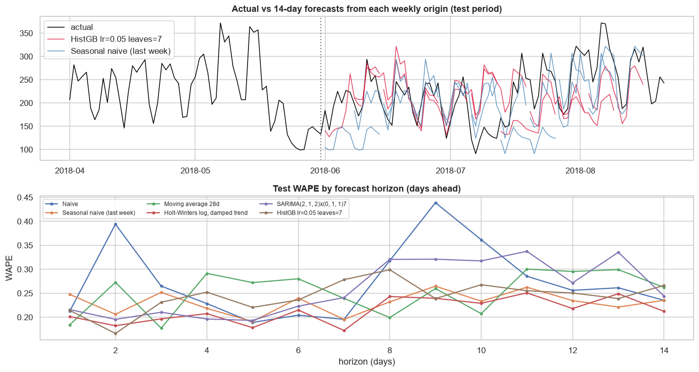

# Time-Series Forecasting: Daily Order Volume (Phase 11)

**Notebook:** `notebooks/10_time_series_forecasting.ipynb`
**Environment:** the project `.venv` (pandas, NumPy, statsmodels, scikit-learn, Matplotlib, Seaborn); no new dependencies, and no deep learning.

## 1. Business problem and target
- **Objective:** forecast **daily orders placed over the next 14 days, issued weekly.** This supports short-term operational planning: customer-service staffing, warehouse and carrier capacity, and seller communication.
- **Target:** the count of orders per purchase day (Gold `fact_orders`, all statuses), 2017-01-01 to **2018-08-21**. The daily totals equal the PostgreSQL view `analytics.sales_daily` exactly.

**Why this target:**

| Candidate | Assessment |
|---|---|
| **Daily orders (chosen)** | 598 consecutive days, a strong and stable weekly cycle (Phase 8: ε² = 0.53), operationally useful |
| Weekly orders | Only 88 weeks: too few for yearly seasonality, and they hide the weekday pattern that matters for staffing |
| Monthly revenue or category sales | Only 20 months: too few for seasonal models or meaningful validation |
| Daily item revenue (secondary) | Not modelled: it correlates 0.97 with daily orders, and average order value is stable (125–152 BRL a month), so revenue ≈ orders × average order value |

**Data-completeness finding:** orders fall from a normal 243–320 a day to 14, 4 and 1 between 2018-08-22 and 2018-08-31. The extract evidently stops capturing new orders (none of those orders is in transit). The series therefore ends on **2018-08-21**. This decision is based only on data completeness, not on model results. Phase 8's STL didn't reveal it, because a decomposition absorbs a gradual decline into the trend.

## 2. Data characteristics
Phase 8 established the trend (STL strength 0.73), weekly seasonality (0.22), the Black Friday spike (2017-11-24, 1,176 orders) and overdispersion. This phase adds the forecasting diagnostics:
- **Variance grows with the level** (28-day coefficient of variation about 0.21), so models use the **log** scale.
- **Stationarity:**
  - In level and log level, ADF and KPSS conflict (KPSS rejects stationarity, p ≤ 0.01).
  - After a first difference of the log, ADF rejects a unit root and KPSS doesn't reject stationarity (p = 0.076).
  - After adding a weekly difference, both tests agree clearly.
- **ACF / PACF of Δ Δ7 log orders:** significant negative spikes at lags 1 and 7 (−0.33 each), and a decaying PACF. This is a non-seasonal MA(1) plus a seasonal MA(1) (the airline-model pattern), which supports SARIMA with d = 1, D = 1, period 7.
- **Yearly seasonality can't be estimated,** because the history is under two years.

## 3. Methodology
- **Rolling-origin evaluation with an expanding window:** at each weekly origin, every model is refitted on the history up to that origin and forecasts the next 14 days.
- **Development (2017-01-01 to 2018-05-31):**
  - 12 validation origins in March–May 2018 select one configuration per model family;
  - the SARIMA order is chosen by AIC on data up to 2018-02-28.
- **Final test:** 10 origins covering 2018-06-01 to 2018-08-16, evaluated **once**.
- **Models:**

| Family | Models |
|---|---|
| Baselines | naive (last value); **seasonal naive** (same weekday last week); 28-day moving average |
| Statistical | Holt-Winters (additive weekly seasonality; log or raw scale; damped or no trend); SARIMA(2,1,2)×(0,1,1)₇ on log1p orders (AIC-selected) |
| Machine learning | HistGradientBoosting (Poisson loss) with lags 14/21/28, a same-weekday lag mean, 7/28-day rolling mean and standard deviation, weekday, month, day of month and a trend term |

- **Leakage prevention:**
  - Each model only receives history up to its origin.
  - The ML model is a **direct** multi-step model whose every input is **at least 14 days older than the target day**, so all 14 forecast days use only data observable at the origin, with no recursion.
  - A notebook test proves it: features built from the full series equal those built from the series truncated at the origin.
- **Metrics:**
  - **WAPE** (primary; robust to zero days);
  - MAE, RMSE, sMAPE, and MAPE (only when every actual > 0; test minimum: 91 orders);
  - bias (Σ error / Σ actual).

  The metric code is verified on a hand-computed example.

## 4. Results
**Validation (March–May 2018), WAPE:**
- HistGradientBoosting: **0.177** (best, so it's the model expected to do best on test)
- Seasonal naive: 0.190
- Holt-Winters (log, damped trend): 0.192
- Moving average: 0.218
- SARIMA: 0.244
- Naive: 0.300

**Final test (June 1 to August 21, 2018):**

| Model | WAPE | vs seasonal naive | MAE | RMSE | MAPE | Bias |
|---|---:|---:|---:|---:|---:|---:|
| **Holt-Winters (log, damped trend)** | **0.214** | **−6.9%** | 47.4 | 61.4 | 0.233 | −8.8% |
| Seasonal naive (last week) | 0.230 | – | 51.0 | 63.9 | 0.246 | −10.0% |
| HistGradientBoosting (validation winner) | 0.246 | +6.6% | 54.3 | 67.6 | 0.265 | −5.4% |
| Moving average 28 days | 0.257 | +11.6% | 56.9 | 70.1 | 0.265 | −11.3% |
| SARIMA(2,1,2)×(0,1,1)₇ | 0.259 | +12.5% | 57.3 | 73.9 | 0.284 | −3.3% |
| Naive | 0.266 | +15.5% | 58.9 | 71.5 | 0.304 | −2.1% |

**Interpretation:**
- **The validation winner didn't generalise.** HistGradientBoosting is 6.6% *worse* than the seasonal naive on test, and better at only 3 of 10 origins. Its 7% validation edge was within period-to-period variation. It is reported, not replaced after the fact.
- **Holt-Winters is the best test model,** 6.9% below the seasonal naive. The gain is **modest and not consistent:** it's better at 6 of 10 origins.
- **The seasonal naive is a strong benchmark.** On this short, drifting series no model beats it by a wide or consistent margin.
- **Error hardly depends on the horizon** (Holt-Winters WAPE 0.20 at 1 day, 0.17 at 7, 0.21 at 14). Uncertainty comes from **level shifts and events**, not from forecast distance.
- **Under-forecasting:** all models under-forecast, mainly because of an unanticipated **August surge.** Volume averaged about 205 orders a day in June–July and **277 in August 1–21 (+36%)**. The largest misses are 2018-08-06/07: 372 and 370 actual against about 203–212 forecast.

## 5. Business interpretation
1. For 14-day operational planning, use **Holt-Winters (log, weekly seasonality, damped trend)**, with the **seasonal naive as a fallback.** Expect about **±21–23% daily error**, and re-forecast weekly.
2. **Add known events manually** (campaigns, Black Friday, holidays). The history is too short to learn yearly effects.
3. **Monitor for level shifts:** if actuals exceed the forecast band for several days (as in August 2018), trigger re-planning instead of waiting for the next forecast.
4. More model complexity (SARIMA, gradient boosting) isn't justified at this data volume. Better gains would come from **more history and event or campaign data.**

## 6. Validation performed
- **Daily aggregation:** equals `analytics.sales_daily` for every day (2017-01-01 to 2018-08-31).
- **Continuity:** a continuous daily index with no gaps (4 zero-order days in early January 2017).
- **Splits:** boundaries asserted, with validation and test horizons inside their periods.
- **No future leakage:** a model-input test for the ML features, and every model refitted per origin on past data only.
- **Baselines and metrics:** baselines implemented directly from the definitions; metrics verified on a hand-computed example.
- **Reproducibility:** fixed seed and deterministic models; repeated executions gave identical results.
- **Execution:** the notebook runs top to bottom with 0 errors and 0 warnings.

## 7. Limitations
- **Short history:** about 20 months, so no yearly seasonality; holidays, campaigns and promotions aren't in the data.
- **Small test:** 10 weekly origins, so differences of a few percent between models aren't statistically robust.
- **Data:** the extract ends early, and the series is cut on 2018-08-21.
- **Point forecasts only:** prediction intervals aren't evaluated, though planning would benefit from them.
- **Aggregate level:** there are no category- or region-level forecasts. Revenue isn't forecast separately (it's ≈ orders × a stable average order value).
