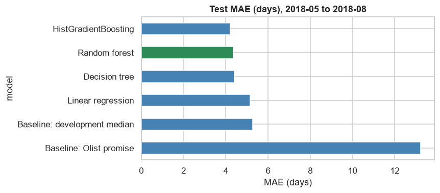
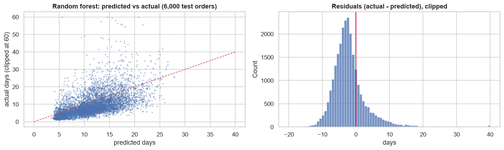
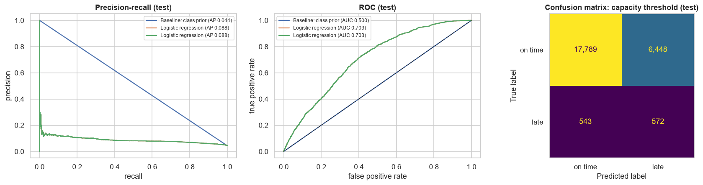
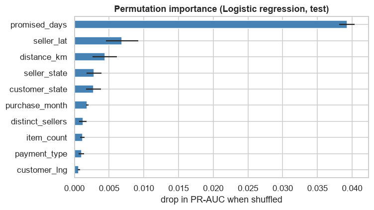

# Machine Learning: Delivery Prediction at Checkout (Phase 10)

**Notebooks:** `notebooks/08_regression_modeling.ipynb` (delivery time) and `notebooks/09_classification_modeling.ipynb` (late delivery).
**Shared dataset:** `src/ml/delivery_features.py`, a single, leakage-checked feature set for both problems.
**Environment:** the project `.venv` with scikit-learn 1.9 (gradient boosting via `HistGradientBoosting*`); no new dependencies. XGBoost, LightGBM and SHAP aren't installed and weren't needed.

## 1. Business problems and targets
Phase 8 showed that the delivery **promise** is very conservative (median 12 days early) and that **missing it** is the strongest driver of bad reviews (1–2 star share 62% vs 9%). Both models therefore serve one decision: what to promise and how to manage risk at checkout.

| | Regression | Classification |
|---|---|---|
| Target | `delivery_days`: actual purchase-to-delivery days (Gold `purchase_to_delivery_days`) | `is_late`: delivered after the promised date (Gold, day level) |
| Question | How long will this order take, and how short can the promise safely be? | Which orders are at risk of being late? |
| Rejected alternatives | Order value: weak business value and little signal at a defensible prediction moment | Negative review: its main driver (lateness) is only known after delivery; predicting it at delivery would leak, and at checkout it would mostly re-predict lateness |

**Population:** D-06 eligible orders (delivered, with a date) with items, purchased in the Q-11 window 2017-01 to 2018-08. That's 96,203 orders, one row each (line and product data aggregated per order; no fan-out).

## 2. Prediction moment, features and leakage prevention
**Prediction moment: checkout.** The 23 features are all known at that moment:
- **The promise shown at checkout,** in days.
- **The basket:** item price, freight, items, products, sellers, weight and volume.
- **Payment:** type and instalments.
- **Location:** customer state and coordinates; the main seller's state and coordinates; the customer–seller distance (haversine between zip-code centroids); whether they're in the same state.
- **The main product category,** and the purchase hour, weekday and month.

**Excluded as leakage**, and enforced by an assertion in the module: approval, carrier and delivery timestamps, all durations, the final `order_status`, reviews and post-purchase quality flags. Post-checkout columns are used only to **define the population and the targets**.

**Preprocessing:** imputation, scaling and encoding live inside scikit-learn pipelines (`preprocessor(kind)`), so they're fitted on training folds only.
- Linear models use median imputation, scaling and one-hot encoding (rare levels < 100 grouped).
- The random forest uses one-hot encoding without scaling.
- HistGradientBoosting uses native handling of missing values and categories.

## 3. Validation methodology
- **Temporal split.** Development: 2017-01 to 2018-04 (70,851 orders). **Test: 2018-05 to 2018-08 (25,352 orders), used once, at the end.**
  - A random split would leak future patterns. It would also hide strong drift: median delivery time fell from 11.3 to 7.8 days, the late rate from 7.6% to 4.4%, and promises changed.
- **Tuning:** `TimeSeriesSplit` (4 expanding folds) within development, using grid or randomised search with modest grids.
- **Selection rule:** the model is chosen on cross-validation, never on the test set. Classification thresholds come from **out-of-fold development predictions**.
- **Validation checks:**
  - one row per order;
  - targets recomputed from Gold timestamps (delivery days exactly; `is_late` against the day-level rule);
  - no feature on the leakage list;
  - development strictly before test;
  - no preprocessing outside the pipelines;
  - seeds fixed at 42, with identical results on re-execution.

## 4. Regression results (test period)
| Model | CV MAE | Test MAE | Test RMSE | Test R² |
|---|---:|---:|---:|---:|
| Baseline: Olist promise used as an estimate | – | 13.23 | 15.84 | −4.77 |
| Baseline: development median | 6.77 | 5.28 | 6.87 | −0.09 |
| Linear regression | 5.50 | 5.15 | 6.66 | −0.02 |
| Decision tree (depth 6) | 5.60 | 4.41 | 6.01 | 0.17 |
| **Random forest (selected on CV)** | **5.38** | **4.37** | **5.92** | **0.19** |
| HistGradientBoosting | 5.38 | 4.22 | 5.84 | 0.22 |

- **Selection:** the random forest and HistGradientBoosting are tied on cross-validation (5.376 vs 5.377). The forest was selected by the pre-defined rule; boosting is slightly better on test (4.22).
- **Improvement:** the selected model cuts MAE by **17%** against the median baseline (5.28 → 4.37 days). The promise itself is no estimator of delivery time (MAE 13.2), because it's a deliberately padded commitment.
- **Errors:**
  - The model overestimates short deliveries (by about 3.8 days at ≤ 10 days) and underestimates long ones (by 7.6 days at 20–30 days, and 22.7 days beyond 30). That's the expected regression towards the mean for a target with a long tail.
  - Errors are largest in Pernambuco and Bahia (MAE 8.0 and 6.9 days) and smallest in São Paulo (3.3).
  - 41% of orders are predicted within 3 days of the actual time.
  - The forecasts carry a −2.4 to −3.0 day bias in June–August 2018, as deliveries sped up after the training period.
- **Predictors (permutation importance):** the promised days (+0.34 days MAE when shuffled), the same-state flag (+0.16) and the customer–seller distance (+0.15), followed by coordinates and seller state.

**From estimate to promise.** A gradient-boosting model with **quantile loss (P95)** sets a promise designed to be met 95% of the time. On the test period:
- **Average promise:** 20.6 days (ML) vs 22.0 days (Olist): **1.4 days shorter**.
- **Share delivered within the promise:** 96.0% (ML) vs 94.5% (Olist): more reliable.

The ML promise is therefore both shorter and more reliable. Its coverage on development data was 95.7%, close to the nominal 95%.

## 5. Classification results (test period, late rate 4.40%)
| Model | CV PR-AUC | CV ROC-AUC | Test PR-AUC | Test ROC-AUC |
|---|---:|---:|---:|---:|
| Baseline: class prior | 0.086 | 0.50 | 0.044 | 0.50 |
| **Logistic regression (selected on CV)** | **0.168** | 0.68 | **0.088** | **0.70** |
| Decision tree | 0.122 | 0.60 | 0.065 | 0.63 |
| Random forest | 0.156 | 0.66 | 0.076 | 0.68 |
| HistGradientBoosting | 0.157 | 0.66 | 0.103 | 0.73 |

- **Metric choice:** with 4–8% positives, PR-AUC is the primary metric; ROC-AUC alone would look flattering.
- **Selection:** logistic regression (balanced class weights, C = 0.01) won on cross-validation. The models are within one CV standard deviation (about 0.08) of each other, and HistGradientBoosting is best on test (not selected; no test-set selection).
- **Overfitting:** the ensembles overfit (train PR-AUC 0.34–0.37 vs CV about 0.16); the regularised linear model generalises best.
- **Thresholds**, fixed on out-of-fold development predictions:
  - flag the top 10% → precision 23.0%, recall 26.7%;
  - F1-optimal → flags 19.8%, recall 42.2%.
- **Threshold drift on test:** the fixed 10% threshold flags **27.7%** of test orders. Promises changed (median 28 days in June, 14 in August 2018), and the promise is the strongest risk signal. **Re-ranking each period and flagging the top 10%** works: precision 10.3%, recall 23.5%, **lift 2.35×**.
- **Errors:**
  - Recall is similar across delay severity (47–57%).
  - The model mostly flags remote regions (Nordeste: 72% flagged, 88% of its late orders caught).
  - Missed late orders are short-distance orders (median 125 km vs 668 km for caught ones) that went wrong after checkout.
- **Predictors:** the promised days dominate (PR-AUC −0.039 when shuffled), followed by seller location, distance and states.

## 6. Clustering (Phase 9, not repeated)
Customer segmentation (RFM rules and K-Means, Phase 9) is **unsupervised**: it groups customers by similarity without a target and is judged by cohesion, stability and business use. The Phase 10 models are **supervised**: they learn a mapping to a known outcome and are judged by error on later, unseen data. The two are complementary, for example monitoring delivery risk by customer segment.

## 7. Business implications
1. **Recalibrate promises with a quantile model.** In the test period, a P95 model would have promised 1.4 days less on average while delivering within the promise more often (96.0% vs 94.5%). Since lateness drives bad reviews, this is the most valuable result of the phase.
2. **Use late-risk scores as a ranking for low-cost actions.** Proactive messages or monitoring for the riskiest ~10% of orders are reasonable uses, because most flagged orders still arrive on time. Re-rank each period instead of using a fixed probability threshold.
3. **Most lateness can't be predicted at checkout.** Better late-risk models need post-checkout signals (approval, carrier hand-over, seller dispatch). That's a later prediction moment, with its own leakage rules.

## 8. Limitations
- **Data:**
  - Only delivered orders have labels (D-06), so undelivered and canceled orders are excluded.
  - Coordinates are zip-code centroids.
  - There's no seller-history feature; time-aware seller statistics would be a leakage-safe extension.
- **Evaluation:**
  - Strong drift over time: performance on a different period could differ.
  - Model differences are within cross-validation noise.
  - Classification scores aren't calibrated probabilities (class weights shift them).
- **Interpretation:** the permutation importances describe what the models use, not causal effects. Detailed explanations (SHAP) belong to the explainability phase.
